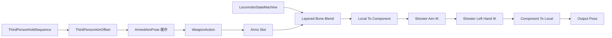
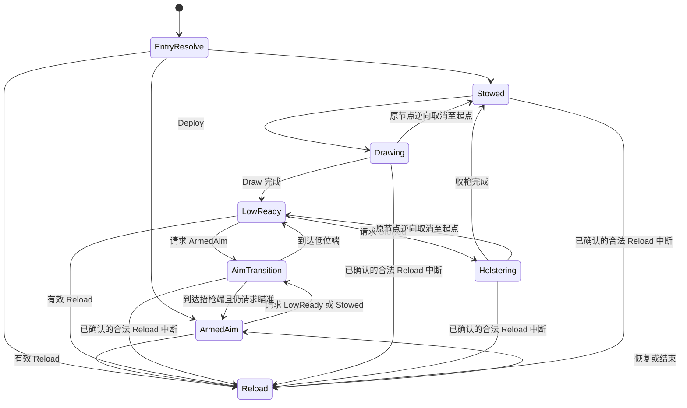

# Rifle 新动画与 WeaponAction 状态机预审查

审查日期：2026-10-10；本地 Git 基线：`3010d93`；安装引擎：UE5.6.1。
本轮只形成方案，没有修改生产代码、AnimBP、Sequence、DataTable 或配置，没有提交 Git。
完整初始提示词已记录在本轮唯一的工作区进度文档中，并按十一项输出要求核对。
审查流程结束后清理临时进度文档，本报告保留结论和证据入口。

结论：现有架构可以承载这些完整人体动画，原生节点也支持可靠的同节点反向播放。
但是，四段动画的端点、取枪位置、FP 修正和装备时序还没有形成可以直接发布的组合。
推荐先完成 Rifle 姿态原型，再接入纯表现意图；不能只增加六个状态就宣称系统完成。

## 证据口径与边界

- 编辑器事实：通过项目 MCP 读取当前图、节点属性、默认对象；TP AnimBP 包未标脏。
- 资产实测：独立 UE5.6.1 Python Commandlet 读取已保存资产，按 30Hz 采样。
- 引擎事实：对照 Epic 5.6 文档与本机源码，不把通用文档当成反向播放的实测结果。
- 设计建议：下文拓扑、裁切候选、倍率和混合参数尚未实施，均需要运行时验收。
- 未验证：带真实武器的皮肤穿模、实际抓握交接帧、FP 最终画面、网络快速中断。

采样采用 RAW 数据、目标 `SKM_Manny_Simple` 和骨架平移重定向选项。
手部差距指同一目标 Mesh 下、IK 前的组件空间距离；不等于游戏中的最终握点误差。
旋转差采用十三个主要上半身骨骼的局部四元数角差，未将手指和辅助骨全部纳入。
表中的末帧索引从零开始；采样键数量比帧间隔数多一。

默认 DDC 初始化曾失败，使用命令行 NoZenLocalFallback 与独立临时 DDC 后采样成功。
这些参数没有写入项目配置；没有调用资产修改、编译、保存或迁移接口。
审查完成时原编辑器进程仍为本轮开始时的同一个进程。
既有 `.gitignore`、`AGENTS.md` 修改和五个未跟踪动画资产均保留。

## 1. 当前 ABP_TP_Player 的真实结构

### 1.1 实际资产与角色

TP 主图：

`/Game/Shooter/Animation/ThirdPerson/ABP_TP_Player`

父类为 `UShooterThirdPersonAnimInstance`，目标 Skeleton 为：

`/Game/Characters/Mannequins/Meshes/SK_Mannequin`

`BP_ShooterCharacter` 的 TP/FP Mesh 均为 `SKM_Manny_Simple`。
因此这里的 `SK_Mannequin` 是项目实际骨架资产名，不能仅凭名字认定为 UE4 三节脊柱。
采样中存在 `spine_01` 到 `spine_05`。
TP 默认直接使用主图；FP 出生默认类为 `ABP_FP_Copy`，首次有效装备后切到固定主图。
正常四枪切换不再重建 TP/FP AnimInstance。

### 1.2 当前连接顺序

外层分支从 `Spine_01` 开始，BlendDepth=1，启用 Mesh Space Rotation Blend。
权重输入为 `WeaponUpperBodyWeight`；没有当前有效装备时为 0，有装备时为 1。
当前更新没有因为 `bIsEquipping` 或某个收枪阶段而平滑降低该权重。
不能用它归零实现 LowReady，否则会露出 Locomotion 上半身，而非指定低位姿态。

TP Arms Slot 的 `bAlwaysUpdateSourcePose=False`。
满权重 Montage 可能停止更新来源 WeaponAction，再触发状态机的相关性重新初始化。
新图应优先评估把 TP Slot 的该项设为 True，以免 Fire 后重播旧 Draw。
这是一项待实施的节点修改，本轮没有改动。

### 1.3 WeaponAction 只有两个状态

Entry 直接指向 ArmedAim。
进入 Reload 条件：

`bIsReloading && !bReloadPresentationRecovering`

返回 ArmedAim 条件：

`!bIsReloading || bReloadPresentationRecovering`

前者混合 0.10 秒，后者混合 0.25 秒；均为 HermiteCubic、普通混合。
自动 Sequence 结束规则关闭，两条过渡优先级均为 1。
状态机允许每帧最多三次过渡，启用首帧跳转特殊处理和重新相关时初始化。
两个现有状态的 Always Reset On Entry 均为 False。

ArmedAim 的实际输出来自 `ArmedAimPose` 缓存。
状态内部仍有旧 Rifle Sequence/AimOffset 节点，但旧 AO 输出没有连到 Result。
不能根据这些旧节点标题判断当前输出资源。

Rifle 数据行当前使用：

- Hold：`MF_Rifle_Idle_ADS`，8.0 秒。
- AO：`AO_Rifle`；X=0，Y=`AimPitchN`，Alpha=1。
- Reload：`MM_Rifle_Reload`，2.2 秒。
- Fire：`FP_Rifle_Shoot_Montage`，通过 TP Arms Slot 播放并由 FP CopyPose 继承。
- Gameplay ReloadDuration=2.5 秒，EquipDuration=0.5 秒。

资源由当前武器配置动态绑定，不能把 ArmedAim 永久写死为 Rifle。

Reload 播放非循环 Sequence。
它在组件空间分别修正 `spine_01/02/03`，输入为 `AimPitchDegrees / -3`。
之后与 ArmedAimPose 按 `RifleReloadWeightedUpperBody` Blend Mask 合成。

### 1.4 ReloadRecovery 与 IK

ReloadRecovery 不是独立状态。
Rifle Reload 在约 1.935083 秒触发 Skeleton Notify，EventGraph 调用 C++ 恢复入口。
该入口在有效 Reload 期间设置 `bReloadPresentationRecovering`，允许提前回到 ArmedAim。
Gameplay Reload 结束后清除闩锁；新的远端 ReloadId 还会重初始化整个 WeaponAction。
扩大状态机后，必须修正这个初始化入口，否则会重置新状态的播放进度。

当前两项 IK 都在外层分层之后执行。
Reload 期间读取 `ReloadIKAlpha`；非 Reload 或恢复阶段则回到正常绑定权重。
当前没有 LowReady、Drawing、Holstering 的 IK 门控。
默认淡出 0.10 秒、淡入 0.15 秒。
新增动作若不处理这些权重，右手瞄准校正和左手握把约束仍可能覆盖原动作。

### 1.5 FP 当前行为

FP 主图只有：

`Copy Pose From Mesh → Arms Slot → Output`

CopyPose 使用附着父 Mesh，`bCopyCurves=False`。
因此 TP 新曲线不会自动成为 FP 的曲线输入；共享阶段值应从 TP 表现快照取得。
FP 的 C++ Proxy 在求值后还会执行近裁剪避让、身体位移和长枪左肘方向约束。
长枪左肘约束当前依据武器握点能力开启，没有根据收拔枪阶段关闭。

已读取默认对象确认：第一人称相机附着于 FP Mesh 的 `head`。
源码中独立于骨骼的相机方案目前被注释，不能当成现行行为。
新动作的头部位移可能改变本机视点，必须在 FP 验收中单独检查。

## 2. 四段动画的实际内容与可用片段

四个实际资产都在：

`/Game/Characters/Mannequins/Anims/Rifle/`

资产名与本轮原始 FBX 名相同，此结论来自 AssetRegistry，不是文件名推断。
四者均为 AnimSequence，并使用与主图、角色 Mesh 相同的 Skeleton。
每段都有 89 条动画轨道，覆盖脊柱、锁骨、上臂、前臂、手及腿部骨骼。
动作段的锁骨、上臂和手部确实发生旋转，不属于仅 FP Arms 的资源。
所有四段 Root Motion=False、ForceRootLock=False、非 Additive、RateScale=1。
四段均没有 Notify、浮点曲线或已配置的握点交接标记。

| 资产 | 时长 | 采样键 | 零基帧范围 |
| --- | --- | --- | --- |
| RifleIdle | 8.566667s | 258 | 0–257 |
| RifleAimToDown | 1.500000s | 46 | 0–45 |
| GrabRifleAndPutBack | 6.166667s | 186 | 0–185 |
| PutBackRifleBehindShoulder | 3.966667s | 120 | 0–119 |

本轮采样中四段 root/pelvis 位置均没有随时间移动。
root 存在约 0.09936cm 的固定高度偏置；外层上半身分层不需要引入其根轨道。
这不证明最终皮肤不会穿模，也不证明头部、手部没有位移。

### 2.1 RifleIdle

可作为 LowReady 循环的首选原型。
首尾右手差 0.016cm，左手差 0.008cm，主要链路最大局部角差约 0.164°。
全段存在小幅持枪呼吸和手部运动，符合循环片段特征。
是否能达到无可见循环接缝，仍需检查首尾速度与实际武器画面。

它与现有 Hold 首帧的左右手位置分别相差约 33.65 / 47.70cm。
这是不同持枪姿态，不能只依靠极短 Blend 把两者当成同一个端点。
低位握持仍要以项目实际 Rifle 的 LeftHandGrip 校准。

### 2.2 RifleAimToDown

正向可以作为抬枪姿态放下到低位的素材。
四十五帧中主要放下动作出现在前段，后段继续调整手掌、头部与姿态。
首帧与当前 Hold 双手相差约 39.20 / 44.30cm。
末帧与 RifleIdle 的右手差约 0.066cm，左手差约 6.864cm。
所以低位端较接近，抬枪端需要明确做姿态对齐。

可测试 0–25 帧副本，删除后段较长的稳定调整。
第 25 帧与 Idle 的右手差约 1.05cm、左手差约 6.77cm，平均局部角差约 5.65°。
它是缩短候选，不是已经验证的最终裁切终点。
原始 0–45 帧必须保留作为对照。

不需要为“引擎不支持逆播”另存反向 Sequence。
5.6.1 的 Sequence Player 初始化会在负速率、有效 StartPosition=0 时自动从片尾开始。
这是初始化时的行为，不代表中途改 StartPosition 就会移动累计时间。
同一节点中改变速率正负号，可以保留当前累计时间而反向推进。

### 2.3 GrabRifleAndPutBack

全段首尾姿态相同，包含取枪、持枪和放回，而非独立 Draw。
采样显示约 1.8–2.2 秒已经到达持枪段，约 2.2–3.1 秒有停留。
第 100 帧附近已明显开始返回。
因此“前 3 秒”包含额外停留，不推荐直接定为正式 Draw。

建议先测试 0–66 帧副本，即 0–2.2 秒。
第 66 帧右/左手前一帧速度约 5.42 / 6.22cm/s，适合作为稳定候选端点。
但它与 Idle 的双手仍差约 8.15 / 11.74cm，需要修正握持端。
第 58 帧虽然位置更接近，右手速度约 53.14cm/s，不宜只按距离最小裁切。
第 90 帧双手差约 7.41 / 12.19cm，延长到三秒没有消除端点问题。

它的右手最高约 118.34cm；Holster 右手则上升到约 192.74cm。
两者并非已匹配的同一条肩后收拔轨迹。
不能把这段直接验收为“从相同肩背 Socket 拔枪”；实际原作取枪位置待带枪确认。
若肩背一致是硬要求，优先测试 Holster 的逆播作为 Draw 对照。

### 2.4 PutBackRifleBehindShoulder

右手有明显过肩运动，约第 42 帧达到采样高度峰值。
后段手臂返回自然下垂，末尾还有稳定调整。
首帧与 Idle 的左右手差约 17.22 / 9.54cm，最大局部角差约 51.61°。
不能认为它一开始就与 LowReady 无缝吻合。

第 90 帧右手仍有约 73.5cm/s 的速度，不宜直接在此截断。
可先测试 0–100 帧副本，即 0–3.333333 秒；保留原始末帧作对照。
第 100 帧右手约 14.12cm/s，仍需更短的收尾姿态修正或平滑到 Stowed。
最终结束点不是本轮已经通过观感验收的结论。

真实肩背存枪需要在接触时切换视觉附着，或换成背部显示代理。
该时刻不能由手腕高度峰值推定；必须根据真实 Rifle、目标背部位置和接触画面确认。
只做显隐可以表达武器离开操作姿态，但不会自动得到一把稳定留在背后的枪。

四段原始动画的头部最大位移分别约 0.63、23.63、10.77、12.36cm。
这些是单独 Sequence 的采样值，不是最终 FP 相机位移。
建议在 Draw、Holster、AimTransition 分支排除颈部/头部运动，保留当前稳定头部姿态。
这可在现有 AnimGraph 内局部处理，无须改变 TP/FP 总体架构。

## 3. 目标状态机是否合理与逻辑冲突

LowReady 作为中转节点是合理的。
正常收枪必须完成降低阶段再进入 Holstering；正常拔枪必须先 Drawing，再 LowReady。
只有六个状态不足以清楚表达指定的 ArmedAim/LowReady 过渡素材。
推荐增加一个 AimTransition 状态，并在同一 Sequence Player 内正反向推进。

Stowed 必须明确是“视觉收起”。
它不自动等价于 Equipment 清空、WeaponActor.Holstered 或 GAS 事务结束。
失效、死亡、真正 Unequip 是高优先级生命周期中断，不能为了完整动画继续持有失效对象。

存在三项需要在实施前解决的冲突：

1. 当前没有 ADS、LowReady 或视觉 Stow 的输入状态。
   AimPitchN 表示视角方向，不是瞄准开关。
2. GAS 的 0.5 秒装备窗口结束后即可按原规则开火。
   若新 Draw 还没完成，不能悄悄让动画延长 Gameplay 禁火时间。
3. 肩背 Holster 与现有 Grab 的轨迹和端点没有匹配。
   反播和普通 Blend 都不能自动修复抓握位置、枪械朝向与接触点。

因此应分开验证“同武器姿态切换”和“跨武器事务”。
本轮方案不把后者假装成前者已经解决。

## 4. 推荐完整拓扑与 Transition 条件

EntryResolve 是初始化解析点，不是日常跳过阶段的捷径。
非 Rifle 分支保持原 ArmedAim/Reload 行为。
新图初始化时优先匹配有效 Reload，其次已有可操作武器的表现目标，再次无武器。
不让已经持枪的角色在相关性重建后无条件重新从背后取枪。

定义：

- Valid：当前 Rifle、Owner、表现绑定有效，且没有死亡/真正 Unequip。
- Goal：纯表现目标 Stowed / LowReady / ArmedAim。
- R：现有 `bIsReloading && !bReloadPresentationRecovering`。
- t：该状态唯一动作 Player 的累计源时间；L：该副本实际长度。
- B：本条过渡时长；v：源时间推进速率，包含 RateScale 与 PlayRate。
- 到达正端：`L - t <= abs(v) * B`。
- 到达逆端：`t <= abs(v) * B`。

| 过渡 | 条件 |
| --- | --- |
| Stowed → Drawing | Valid，Goal 非 Stowed，新一次 Deploy |
| Drawing → LowReady | 未取消，动作到达持枪端 |
| Drawing → Stowed | 已请求取消，原 Player 退回收起端 |
| LowReady → AimTransition | Valid，Goal=ArmedAim，R=false |
| ArmedAim → AimTransition | Valid，Goal 非 ArmedAim，R=false |
| AimTransition → ArmedAim | Goal=ArmedAim，到达抬枪端 |
| AimTransition → LowReady | Goal 非 ArmedAim，到达低位端 |
| LowReady → Holstering | Valid，Goal=Stowed，R=false |
| Holstering → Stowed | Goal=Stowed，到达收枪端 |
| Holstering → LowReady | Goal 非 Stowed，原 Player 退回持枪端 |
| ArmedAim / LowReady → Reload | Valid，R=true |
| 其余四个 Rifle 状态 → Reload | Valid，已有合法 R=true，高优先级中断 |
| Reload → ArmedAim | Valid，R=false，沿用恢复与结束规则 |

所有失效/死亡/真正 Unequip 路径优先退出到安全无武器输出并清理表现状态。
这属于生命周期例外；不要求已销毁武器继续完成低位和收枪阶段。

所有普通部署、取消和端点出口还需 R=false，以免与已确认的 Reload 同时成立。
新纯表现阶段目前不限制 GAS Reload 资格，不能等收拔枪结束才表现合法 Reload。
因此过渡态及视觉 Stowed 收到有效 Reload 时，恢复手部显示并中断到原 Reload。
这属于已有 Gameplay 动作覆盖例外，不是正常部署路径的捷径。
若要求 Stowed 下必须先完成取枪才能接受 Reload，需另行授权修改其可用性规则。

现有 Reload 以 ArmedAimPose 为基底，默认结束仍先回 ArmedAim。
若结束时 Goal=LowReady/Stowed，再走 AimTransition，避免直接混到差距很大的低位。
若要 Reload 直接返回 LowReady，必须先补做末帧衔接，不能只改返回条件。
恢复期间应阻止旧 Reload 再入，只有新一次 Reload 身份才允许重新播放。

优先级建议：生命周期失效最高，其次有效 Reload，再次最新表现意图，最后动作结束。
同一出口的条件需互斥，不能仅靠优先级掩盖冲突。
LowReady 应是真实输出状态，至少更新一次后再允许继续 Holstering 或 AimTransition。
建议增加节点更新的本地到达标记，不能只依赖延迟到达的 Notify。
不要用无条件 Conduit 串联，让一帧三次跳转把中转姿态完全略过。

## 5. 每个状态的素材、方向与循环规则

| 状态 | 素材 | 播放规则 |
| --- | --- | --- |
| Stowed | Locomotion 或有效收尾姿态 | 不输出持枪 AO |
| LowReady | RifleIdle 副本 | 正向循环，Rate=1 |
| ArmedAim | 现有 Hold + AO | 保持当前资源绑定 |
| AimTransition | AimToDown 裁切副本 | 正向降低，负速率抬起，非循环 |
| Drawing | 确认后的 Draw 副本 | 非循环；取消在原节点逆向 |
| Holstering | Holster 副本 | 正向收起；取消在原节点逆向 |
| Reload | 现有 Reload Sequence | 非循环，保留 Notify/曲线 |

Drawing 的来源需要先作素材决定。
接受现有 Grab 的取枪位置时，测试其 0–66 帧副本。
要求与肩背 Holster 一致时，优先以调整后的 Holster 副本逆播作为 Draw 原型。
后者可以共享同一 Sequence，无需为了逆播另存资产。
若要求清晰的独立资源命名，可在授权实施后制作反向副本，但不是引擎兼容性要求。

AimTransition 中，t=0 是素材抬枪端，t=L 是素材低位端。
由 ArmedAim 进入设 t=0、v>0；由 LowReady 进入设 t=L、v<0。
中途意图反转只改变速率符号，不重置累计时间，也不换到另一段从头播放。

StartPosition 在初始化时有效。
节点再次相关但仍处于混合链中时，不应假定 StartPosition 会被重新应用。
采用原生 On Become Relevant 与 SequencePlayerLibrary.SetAccumulatedTime 设置入口时间。
实际可动态修改的属性要设为动态；SetPlayRate/SetStartPosition 对常量数据可能失败。
不要每帧调用 SetAccumulatedTime，否则 Player 会被持续重置。

Drawing 和 Holstering 取消也优先原节点倒退。
Holstering 未完成便重新部署，仍在原动作倒退，回到 LowReady 后再处理瞄准。
它尚未真正到达 Stowed，所以不构成从 Stowed 跳过 Drawing。
Drawing 未完成便取消，则沿同一取枪轨迹退回收起端。
动画中途在手/背之间的显隐或交接必须随时间反向恢复，不能只靠一次 Notify。

UE5.6.1 本机状态机的自动规则直接以 `Length - AccumulatedTime` 判断结束。
这不能作为本方案负速率 Player 的可靠退出规则。
显式 Relevant Time Remaining 走速率方向调整，但返回的是源时间量，需结合倍率解释。
首版全部动作出口采用指定 Player 的显式方向端点条件。

不要把 SyncGroup 同步、姿态匹配起播或 Inertialization 一并加入首版。
当前不需要用它们解决累计时间保留。
先采用短 Standard Blend；大端点差必须修动作，不能靠惯性混合隐藏。

## 6. 裁切帧、时长与混合参数

所有裁切仅建议在副本中测试，本轮没有覆盖原始 Sequence。
正式副本建议放在现有 Shooter 动画目录下的 Rifle 子目录。
MM_Rifle_LowReady、MM_Rifle_AimToLowReady、MM_Rifle_Draw、MM_Rifle_Holster 符合现有习惯。
当前文本规范没有单独强制动画前缀，不能称命名规则已自动验收。

| 用途 | 零基裁切候选 | 原型时长 |
| --- | --- | --- |
| LowReady | Idle 0–257 | 原速循环 |
| AimTransition | AimToDown 0–25 | 0.25–0.35s |
| Draw 对照 | Grab 0–66 | 先 0.70–0.90s |
| Holster | PutBack 0–100 | 先 0.75–1.00s |

AimTransition 候选长 0.833333 秒，播放 0.25 秒时速率约 ±3.33。
Grab 候选长 2.2 秒，播放 0.8 秒时倍率 2.75；压到 0.35 秒则约 6.29。
Holster 候选长 3.333333 秒，播放 0.8 秒时倍率约 4.17；压到 0.35 秒则约 9.52。
后两者的极短时长只适合压力测试，不能作为自然动作已经成立的结论。
应先去除等待并修正端点，必要时改中段关键帧，不继续无限加速。

普通 HermiteCubic 混合初值：

- ArmedAim/AimTransition/LowReady 之间：0.08–0.12 秒。
- Draw/Holster 与端点：0.10–0.15 秒。
- 同节点反向：保留 t，测试 0.03–0.05 秒的速率换向缓冲。
- Reload 进入/退出：保留当前 0.10 / 0.25 秒。
- 两项 IK：先沿用 0.10 秒淡出、0.15 秒淡入，再根据短动作调整。

暂不新增 Blend Profile。
只有确认手腕与脊柱需要不同混合速度后再加，避免同时引入多个变量。
不预设 Inertialization；本机没有该节点，使用它还需要增加图节点并检查大姿态差。

## 7. IK、Socket、Arms Slot、Reload 与中断处理

### 7.1 IK 与上半身

Aim IK 在 LowReady、Stowed、Drawing、Holstering 中的阶段门控应为 0。
AimTransition 靠近 ArmedAim 端时平滑恢复，不能按输入意图瞬间置满。
阶段门控与现有绑定有效性、Reload 门控相乘，不替代它们。

LeftHand IK 在抓取/放手阶段释放，双手握持成立后再恢复。
LowReady 可以保持握把约束，但需要以真实 Rifle 的 LeftHandGrip 验收。
Reload 继续使用原 ReloadIKAlpha 曲线，不由新曲线覆盖弹匣动作。

动作途中保留 WeaponUpperBodyWeight，Stowed 使用 Locomotion 时再平滑降低。
当前 C++ 每帧写 0/1，正式接入需要改为根据表现阶段生成目标权重。
死亡或真正 Unequip 清理失效绑定，不为了完整动作保留旧武器引用。

Draw/Holster/AimTransition 需要局部排除头颈覆盖，保持 FP 视点稳定。
FP 近裁剪保护保留，长枪左肘固定方向约束在离枪动作中释放、握持后恢复。
FP CopyPose 不复制曲线，新阶段值应由 TP 表现快照取得。

### 7.2 Socket 与显示

FP/TP 真实 Weapon Mesh 当前都挂在 HandGrip_R。
角色 Socket 读取结果没有已有肩背武器 Socket。
Rifle 实际枪口为 Muzzle、握点为 LeftHandGrip。

HasCompleteWeaponPresentation 要求真实 Weapon Mesh 仍挂手部，且 Actor 未隐藏。
把真实 TP Mesh 直接改挂背部，会违反完成条件并可能被幂等修复重新挂回手上。
它还会改变服务器实际枪口位置，不能仅靠 Notify 随意重挂。

最小原型优先采用组件级视觉显隐。
不要用 Actor.Hidden 表示纯视觉 Stowed，GA_Fire 会读取它作为资格条件。
若必须持续在背部看到枪，增加轻量视觉 Mesh 代理，保留正式 Weapon 的附着契约。
这不需要新 Subsystem，也不要求替换当前武器系统。

真实交接帧要通过实际 Rifle 和背部目标的接触画面确定。
手腕高度峰值不是可靠的交接帧，本轮不虚构一个最终帧号。
显隐/代理选择应由阶段、源时间和动作身份重复计算。
Notify 可辅助音效，不能是唯一交接事实，避免逆播、中断或低权重漏播。
既有弹匣代理仍独立服务 Reload，不用于修改整把枪的身份。

### 7.3 Fire、Reload 与生命周期

Fire 保留现有合法路径和 Arms Montage，Owner 瞬时反馈不能等抬枪结束。
可以同时请求 ArmedAim，但它只改变画面目标，不成为新开火门控。
必须实测现有 Fire Montage 与 LowReady/Draw 的覆盖是否产生突跳。
若发生冲突，先修素材和时序，不能默默增加动画禁火 Tag。

TP Slot 保持当前位置，建议启用 Always Update Source Pose。
FP 继续 CopyPose，不另外播放一套与 TP 独立的 Draw/Holster。

Reload 从 ArmedAim/LowReady 进入，内部保持当前 ArmedAimPose 基底。
过渡态或视觉 Stowed 中收到已确认的合法 Reload，也按高优先级中断进入。
这时需恢复握持显示和既有 Reload IK，不能排队等待表现动作结束。
默认恢复先回 ArmedAim；若仍请求低位/收枪，再走 AimTransition。
保留音效、弹匣 Notify、Recovery 和 Gameplay 时钟。
远端新 ReloadId 的重初始化必须与 EntryResolve 配合，直接进入有效 Reload。
不能重置到 Stowed 后重新取枪，也不能让旧 Recovery 阻止新 Reload 重播。

Death、真正 Unequip、Owner 或 Weapon 失效优先清理。
旧上下文的 Montage、代理显示、IK 和累计时间不能继续应用到新武器。
动画结束不清空 Equipment，也不提交 Gameplay 事务。

### 7.4 七种中断

| 场景 | 最小处理 |
| --- | --- |
| 动作未完请求返回 | 同 Player 保留 t 后倒退 |
| 抬枪一半又低位 | AimTransition 改正速率，到低位端 |
| 降枪中直接请求收枪 | 先到 LowReady 实际更新，再 Holster |
| Drawing 被取消 | 原取枪 Player 逆向退回收起端 |
| Holstering 重新部署 | 原收枪 Player 逆向回 LowReady |
| 短时间连续变化 | 同身份保进度，新身份清旧进度 |
| 基础姿态泄漏/肩抖 | 保动作层权重，协调 IK，修端点 |

重入仍有混合权重的状态不保证重新初始化。
Always Reset On Entry=False 可能保留旧时间，True 可能强制回到端点。
不能把任一个选项当成所有场景的万能解法。
以同节点反转、真正新动作显式起点、身份变化清理为验收规则。
靠近状态边界的反复输入也要测，不能只测动作中段。

## 8. C++ 属性、GameplayTag 与表现变量

### 8.1 当前时序

已有 CurrentWeaponActor、bIsEquipping、Reload 状态、ReloadId 和两项 IK 权重。
没有现成的 ADS/LowReady/Stow 输入，也没有动画所需的装备开始时间和目标快照。

GA_Equip 为 ServerOnly，等待目标武器 EquipDuration，然后原子提交 CurrentWeaponActor。
Rifle 数据行当前值确为 0.5 秒，不只是 C++ 默认值。
提交后表现收敛隐藏旧武器、绑定新资源，随后能力结束。

本机有效 ReplicateActivationOwnedTags=True。
本机 5.6.1 对 ServerOnly 的 Owned Tags 使用 Replicated Loose Tags。
但 Tag 与 Equipment 指针没有跨组件原子到达保证。
短事务也不保证每个观察者看见每个中间标签变化。
State.Equipping 无法提供目标身份、动作次数或精确时间。

### 8.2 最小新增方案

先用 AnimBP 预览 Goal 验证素材，不立即新增 GameplayTag。
正式输入在现有 Character 表现职责内增加三值意图：

Stowed / LowReady / ArmedAim。

本机即时应用；需要观察者同步时，提供关联 WeaponActor 与 Revision 的小型表现快照。
网络入口仍校验角色归属，晚到意图不能作用于已经换出的武器。
这是表现身份，不是新增装备权威。
纯本机原型不需要新网络快照。

AnimInstance 最少需要：

- Rifle Goal、有效性和非 Rifle 回落。
- 动作身份/版本，拒绝旧交接事件并清理旧进度。
- Player 累计源时间、方向和入口时间，可由原生节点函数维护。
- AimPoseAlpha、GripPoseAlpha 与上半身目标权重。
- LowReady 已实际更新标记。
- 四项新动画引用，通过现有资源配置和绑定入口扩展。

无需 State.Drawing、State.Holstering、State.LowReady 等 GameplayTag。
无需新 Subsystem、自定义 AnimNode 或独立 Gameplay 状态框架。
也不复制一个新的装备身份来替代 CurrentWeaponActor。

### 8.3 0.5 秒与可开火边界

0.5 秒是服务器提交等待，不是完整视觉收拔枪时长承诺。
当前自然原型的收、拔、降低组合明显超过它。
只在提交时开始 Draw，会出现服务器已可开火、画面仍取枪的窗口。
只靠事务 Tag 也不能在客户端提前正确显示尚未确认的新武器。

如果完整跨枪过程要从事务开始表现，需要现有表现层补足目标身份和开始/取消上下文。
动画只消费上下文，不决定提交。
这作为后续独立步骤，不能描述为当前已有能力。

禁止延长 Owned Tag、等待动画 Notify 或延迟 GA_Equip 提交以迁就素材。
如果 Stowed 必须无法开火，那是新增 Gameplay 规则，需要另行授权。
本方案没有擅自采用它。
在这个决策前，Stowed 原型只能验收姿态和显示，不能验收完整可玩收枪功能。

## 9. 哪些只改 AnimBP，哪些必须改 C++

AnimBP 和资产副本能完成：

- 增加 LowReady、Drawing、Holstering 和 AimTransition。
- 原生 Player 正反向、明确时间出口和混合参数。
- 保留 ArmedAim 缓存、Reload 图和外层 Slot 顺序。
- 测试裁切、端点修正、头颈排除和循环。
- 保持 Slot 来源更新，并用预览 Goal 验证本地状态。

正式接入 C++ 需要：

- 真实输入/自动意图，必要的观察端表现快照。
- 扩展现有武器配置与绑定，Rifle 缺资源时回落，另外三枪保持旧路径。
- 上半身平滑权重、新阶段 Aim/LeftHand IK 门控。
- FP Proxy 长枪左肘约束的阶段释放。
- ReloadId 初始化适配、动作身份和生命周期清理。
- 若需要肩背持续显示，管理视觉代理和可重复计算的交接。

预览可在图中将原 IK Alpha 乘门控验证，不代表正式所有权已经处理。
正式版应保留现有 C++ 权重拥有者，避免同一变量由多个位置反复写入。
AnimBP 不修改 CurrentWeaponActor，不调用装备提交。

## 10. 最小分阶段实施与回归

本轮以下阶段全部未实施，没有运行全量回归。

### 阶段一：素材与姿态

在独立项目或授权工作副本中复制素材。
确定 Grab 对照或逆播 Holster 的取枪来源，校准两端 Hold/LowReady。
使用实际 Rifle 选择接触帧，检查握点、手指、枪托、肩膀和头颈。
记录最终裁切帧，不继续拿本报告候选帧当成通过结论。

### 阶段二：Rifle 状态原型

保持当前外层图，只扩展 WeaponAction。
使用受控 Goal 测站立、移动、跳跃与七种中断。
测状态边界、低帧率、大 Delta、Fire 满权重覆盖和相关性丢失。
记录 t、方向、动作身份和 LowReady 实际更新。
通过条件是没有旧动作重播、同帧绕过中转、单帧参考姿态或肩膀突跳。

### 阶段三：IK、FP 与已有动作

接入新阶段 IK、上半身权重和 FP 左肘释放。
检查 FP CopyPose、近裁剪、头部与相机位置。
保持 Reload 的音效、弹匣交接和 Recovery。
新 ReloadId 到达必须重播 Reload，不能从 Stowed 重演取枪。
另外三枪只做旧图回落检查，不推广新动作。

### 阶段四：表现输入与网络上下文

在现有 Character/Equipment 职责内接入最小上下文。
验证拥有端即时意图、观察端收敛、身份晚到、快速切枪和取消。
保留 0.5 秒提交与真实武器手部附着，再确定显隐或背部代理。

### 阶段五：权威枪口与定向网络验收

CalculateProjectileSpawnTransform 使用 TP 真实 Muzzle 世界位置。
TP 新姿态即使没有改 GAS，也可能改变弹丸起点。
相机仍挂 head，姿态还可能改变视点与瞄准目标采样。
不能以纯动画为理由宣称命中路径不受影响。

按项目五条不变量选择最小充分证据：

- Owner Immediate Feedback：姿态不延迟瞬时反馈，不补播历史枪声/后坐力/FX。
- Local Prediction Obeys Weapon Rules：保留确定已知的规则，不吞 Shot Intent。
- Server Is Final Authority：时钟、武器身份、Ammo 与弹丸只由服务器决定。
- Remote Is Confirmed Only：远端 Fire 不由本地姿态意图猜测触发。
- Exactly One Authority Result：快速中断和跨枪不额外生成弹丸或重复扣弹。

场景包含 Listen、Dedicated、拥有者、观察者、近墙与俯仰边界。
记录 TP Muzzle、实际生成变换、提交武器身份、次数及反馈来源。
生成点变化要与目标行为比较，不能在没有证据时承诺与旧坐标完全相同。
修改后按项目门禁编译并定向测试；正式网络完成声明仍遵循完整验收契约。
本轮没有用任何历史绿色结果代替本次验证。

## 11. 需要用户确认的观感与产品决策

1. Draw 是否必须与肩背 Holster 使用同一存枪位置。
   肩背一致时先试 Holster 逆播；保留 Grab 作对照。
2. 候选 25/66/100 帧经带枪预览后，是否允许删除更多准备和收尾。
   这些是测试起点，不是最终已验收帧。
3. 自然节奏与极短竞技 FPS 动作哪个优先。
   大倍率失真时应修改关键帧。
4. Stowed 是否必须禁火。
   禁火属于新增 Gameplay 规则，本轮没有采用。
   同样需确认是否允许已有合法 Reload 覆盖视觉收起/取枪阶段。
5. LowReady 来自显式按键、自动闲置，还是某种模式。
   当前没有 ADS 开关，不能拿 AimOffset 推断。
6. 收起后只显隐是否足够，还是需要背部持续显示代理。
7. 最终左手握点、枪托肩部关系、FP 占屏与近裁剪是否符合期望。

建议首次实施授权限定在阶段一和二。
先证明素材端点和中断原型，再确定 Gameplay 行为和网络表现范围。
本轮审查流程完成，等待实施授权，没有开始生产改动。

## 证据与外部依据

本轮独立审查目录保留原始提示词、编辑器读取结果和逐帧数据：

C:/Users/HP/.codex/visualizations/2026/10/10/01a123fe-b50e-7a92-a254-9edece4ab99e/

- rifle_samples.json：逐帧骨骼、Socket、曲线、轨道和 Notify。
- rifle_pose_summary.json：端点差与候选片段摘要。
- rifle_editor_evidence.json：当前图、节点与默认对象。
- rifle_context.json：相机附着、Owned Tags 配置与 Rifle Socket。
- rifle_extra.json：只读导出的当前武器数据表。
- Rifle预审查初始提示词.txt：附件原文保留副本。

主要项目依据：

- [TP 表现与 IK](D:/Unreal_Projects/ShootGame/Source/ShootGame/Characters/Animation/ShooterThirdPersonAnimInstance.cpp:473)
- [FP 局部修正](D:/Unreal_Projects/ShootGame/Source/ShootGame/Characters/Animation/ShooterFirstPersonAnimInstance.cpp:24)
- [装备等待](D:/Unreal_Projects/ShootGame/Source/ShootGame/AbilitySystem/Abilities/ShooterGameplayAbility_Equip.cpp:157)
- [表现附着契约](D:/Unreal_Projects/ShootGame/Source/ShootGame/Characters/ShooterCharacter.cpp:861)
- [服务器枪口](D:/Unreal_Projects/ShootGame/Source/ShootGame/Weapons/ShooterWeapon.cpp:1292)

UE5.6.1 本机核对包括 Build.version、AnimNode_SequencePlayer.cpp、
AnimNode_StateMachine.cpp、SequencePlayerLibrary.cpp、AnimNode_Slot.cpp 与 GameplayAbility.cpp。
初始化自动从片尾起播，与运行中反向保留时间是两项不同的行为。
自动规则使用源累计时间的细节也经过本机源码核对，没有仅凭通用文档推断。

外部依据为 Epic 5.6 的状态过渡、节点函数、Player 时间接口和动画分层资料。
它们支持原生节点方案；当前项目连接和素材内容由本地读取证明。
相关官方页面：

- [过渡规则](https://dev.epicgames.com/documentation/en-us/unreal-engine/transition-rules-in-unreal-engine?application_version=5.6)
- [动画节点函数](https://dev.epicgames.com/documentation/en-us/unreal-engine/animation-blueprint-node-functions-in-unreal-engine?application_version=5.6)
- [SequencePlayerLibrary](https://dev.epicgames.com/documentation/en-us/unreal-engine/python-api/class/SequencePlayerLibrary?application_version=5.6)
- [上半身分层](https://dev.epicgames.com/documentation/en-us/unreal-engine/using-layered-animations-in-unreal-engine?application_version=5.6)
