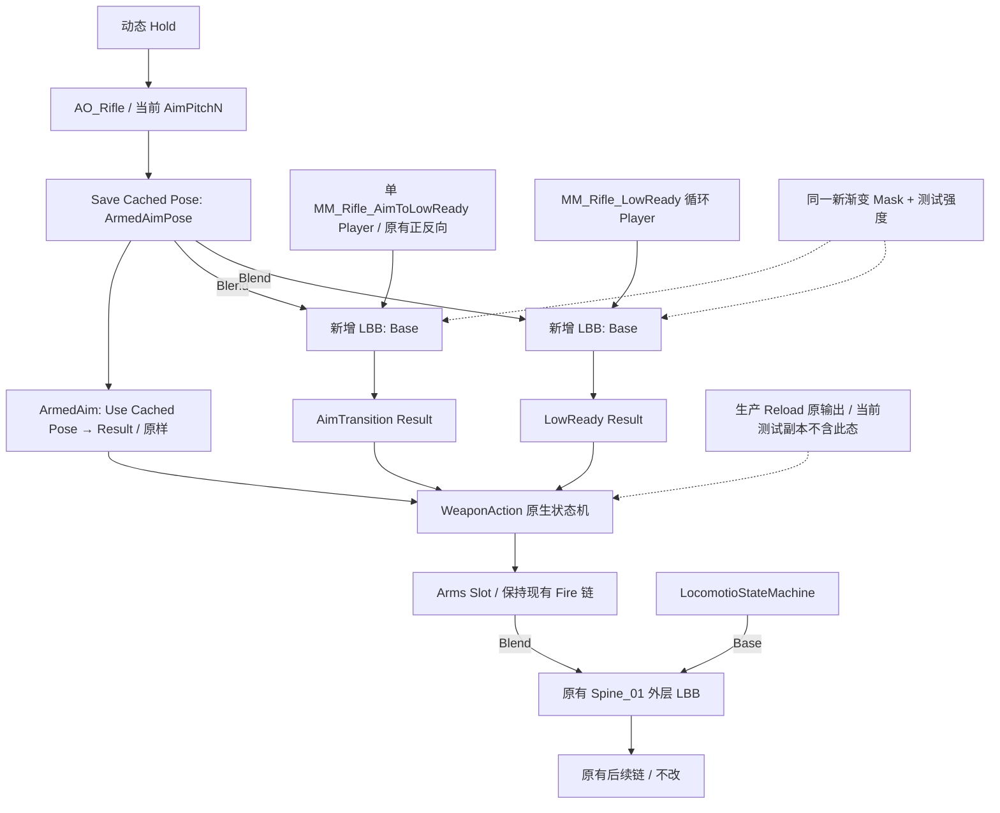

# Rifle 俯仰姿态与 Blend Mask 可行性专项审查

## 1. AO_Rifle 俯仰骨骼分析

审查日期：2026-10-10；本机 UE 5.6.1，CL 44394996。
本轮只读，没有运行新姿态实验，没有修改或保存生产、测试资产。
已参考两份指定报告，并重新核对当前编辑器图、磁盘资产和既有运行时 CSV。

**自然头部俯仰由脊柱累计旋转与颈头自身旋转共同实现，且上下明显不对称。**
上仰更多依赖颈头链；下俯更多依赖胸部累计旋转。
现有证据不能精确分配 neck_01、neck_02、head 各自的运行时份额。
不能据此认定 Head-only 遮罩自然，也不能认定必须接管全部脊柱。

### 实际 ArmedAimPose 来源

生产与测试图的共同上游是：

```text
ThirdPersonHoldSequence → Sequence Player
                       → AO Player 的 BasePose
ThirdPersonAimOffset ──→ AO Player 的 BlendSpace
X=0，Y=AimPitchN，Alpha=1
                       → Save Cached Pose: ArmedAimPose
                       → ArmedAim 状态的 Use Cached Pose → 状态输出
```

Rifle 对应 Hold 为 `MF_Rifle_Idle_ADS`，8 秒循环、非加法动画。
AO 为 `AO_Rifle`，不是 ArmedAim 状态内部那组未接到 Result 的旧节点。
俯仰输入为 `sin(Pitch)`，因此 ±30° 对应 ±0.5，±60° 对应约 ±0.866。
AO 的实际样本如下，全部为 Mesh Space Rotation Additive：

| Y | 实际采样动画 |
| --- | --- |
| +1 | MM_Rifle_Idle_ADS_AO_CU |
| 0 | MM_Rifle_Idle_ADS_AO_CC |
| -1 | MM_Rifle_Idle_ADS_AO_CD_Fixed |

X、Y 范围均为 [-1,1]，三个样本的 X 均为 0。
当前各轴 InterpolationTime=0，TargetWeightInterpolationSpeed=0。
实际采样沿上述中心竖线混合；±60° 并非直接播放 ±1 端点样本。
各样本的加法参考均为 Hold 第 0 帧，中心 CC 也不能先验视为零增量。
RotationOffsetBlendSpace 先求值动态 Hold，再叠加混合后的 Mesh Space 加法姿态。
因此完整 ArmedAimPose 同时包含 Hold、AO、采样混合及动态播放相位。

其后是 WeaponAction → Arms Slot → 外层 Layered Blend per Bone。
外层 Base 为 LocomotioStateMachine，Blend 为 Arms Slot。
外层过滤为 Spine_01、Depth=1，Mesh Space Rotation Blend=True。
Depth=1 覆盖 spine_01 及全部后代，root、pelvis、腿仍由 Locomotion 提供。
满上半身权重时，目标完整姿态的组件旋转保留，边界 Local Rotation 重新补偿。
所以 P0 pelvis 的旋转可参与目标脊柱朝向，但不代表最终 pelvis 被 AO 接管。

本轮读取确认的真实层级为：

```text
root → pelvis → spine_01 → spine_02 → spine_03 → spine_04 → spine_05
                                                               ├→ neck_01 → neck_02 → head
                                                               ├→ clavicle_l → 左臂
                                                               └→ clavicle_r → 右臂
```

### 既有运行时测量

使用方案 A 的 `nodes_component.csv`，仅取五个 Pitch 场次开头 ArmedAim 满权重帧。
每场次先保留 30 帧，再取最后 10 帧进行符号对齐、归一化四元数平均。
采样帧分别为 -60°：931～940；-30°：741～750；0°：171～180；
+30°：361～370；+60°：551～560。
没有 Montage；上半身满权重；参考为 0° 场次的真实 P0 平均姿态。

下表单位为度，表示四元数最短旋转角距。
它们不是带符号的 Euler Pitch，也不能相加或换算为贡献百分比。
各场次 Hold 相位不同且未导出，数值包含少量底姿态相位差。
所选窗口内脊柱旋转的最大半径约 0.084°，不等于跨相位误差上限。
这足以支持明显的分布不对称，不足以宣称精确 AO 单骨贡献比例。

**骨骼自身 Local Rotation 相对平视的变化：**

| 骨骼 | -60° | -30° | 0° | +30° | +60° |
| --- | --- | --- | --- | --- | --- |
| spine_01 | 4.38 | 2.52 | 0 | 7.79 | 13.46 |
| spine_02 | 6.70 | 3.88 | 0 | 1.63 | 2.81 |
| spine_03 | 6.77 | 3.93 | 0 | 1.55 | 2.75 |
| spine_04 | 6.82 | 3.95 | 0 | 1.55 | 2.74 |
| spine_05 | 6.82 | 3.92 | 0 | 1.55 | 2.68 |
| neck_01 | 未导出 | 未导出 | 参考 | 未导出 | 未导出 |
| neck_02 | 未导出 | 未导出 | 参考 | 未导出 | 未导出 |
| head | 未导出 | 未导出 | 参考 | 未导出 | 未导出 |

**P0 Component Space Rotation 相对平视的变化：**

| 骨骼 | -60° | -30° | 0° | +30° | +60° |
| --- | --- | --- | --- | --- | --- |
| pelvis | 12.43 | 6.52 | 0 | 2.03 | 4.15 |
| spine_01 | 9.38 | 4.81 | 0 | 9.62 | 17.34 |
| spine_02 | 15.91 | 8.60 | 0 | 9.07 | 16.27 |
| spine_03 | 22.65 | 12.52 | 0 | 8.73 | 15.61 |
| spine_04 | 29.46 | 16.47 | 0 | 8.62 | 15.38 |
| spine_05 | 36.28 | 20.38 | 0 | 8.84 | 15.67 |

下俯时 spine_02～05 各自有约 6.7°～6.8° 的局部变化，形成更大的胸部累计变化。
上仰时腰部 spine_01 较明显，后四节较小，并非全链同向均匀分摊。
例如 +30° 的 spine_05 自身仅变约 1.55°，组件朝向已变约 8.84°。
组件数值包含父链贡献，尤其不能把 pelvis 行直接解释为最终腰部运动量。

既有 `bones_component.csv` 另有最终 P3 的 head 与 spine_05 组件四元数。
同帧计算 `inverse(Q_spine_05_CS) × Q_head_CS`，可得到颈头整条链的合成旋转。
这是三个局部四元数的乘积，不能拆分成三根骨骼的单独旋转。

| 输入 | P3 head 组件角距 | 颈头链相对胸部的合成角距 |
| --- | --- | --- |
| -60° | 46.60° | 11.65° |
| -30° | 26.96° | 7.25° |
| 0° | 0° | 0° |
| +30° | 43.34° | 36.03° |
| +60° | 76.21° | 62.83° |

以上 head 是实际 P3 测量，不冒称直接导出的 P0 head。
所选帧 P0/P2 脊柱组件旋转差、P2/P3 差均不超过约 0.000002°。
外层满权重保留颈头目标组件旋转，既有两项 IK 的写入范围不包含脊柱或颈头。
结合当前图与源码，可以将这组颈头合成变化作为 ArmedAim 的间接佐证。
仍无法补出 neck_01、neck_02、head 的单骨 P0 Local / Component 表。

静态源姿态只能辅助解释作者如何分配动作。
既有 CU 样本相对 Hold 第 0 帧的 Local 角距为：
neck_01 约 32.50°、neck_02 约 9.59°、head 约 51.37°。
这些是静态端点与参考帧的比较，不是 +60° 的真实 ArmedAim，也不是相对 P0 平视。
它支持上仰时 head 自身存在明显运动，不能据此说头部主要是被父级带动。
下俯的运行时单骨分配、以及某根颈头骨几乎不动的结论，当前证据均不足。

**需要保留的是颈头链自身的变化和合适的胸部累计朝向来源。**
完整自然分配涉及 spine_01～05、neck_01、neck_02、head，另有 AO pelvis 的输入贡献。
但使用 Mesh Space 遮罩时，头颈的目标组件旋转已经包含整个来源父链的累计贡献。
因此不必为了得到头部目标朝向而把所有脊柱都设成高权重。
需要通过渐变范围控制补偿落在哪些关节，避免把全部差异集中到 head 或 neck_01。

生产图、Skeleton、Hold、AO 及三个采样、两段 Mixamo 动画的文件哈希与旧运行一致。
测试副本当前下游配置与旧运行并非完全一致；本轮没有拿旧 P3 枪械验收当前副本。
本轮量化仅使用有明确来源的 P0 脊柱及上述颈头间接证据。

[量化数据](D:/Unreal_Projects/ShootGame/Saved/RiflePitchMaskAudit/existing_csv_analysis.json)

### 缺失条件

要精确回答三根颈头骨各承担多少，需要同帧、同 Hold 相位的 P0 全链 Local / CS 数据。
现有导出器主动过滤掉了 neck/head，并且没有记录 Hold Player 时间。
本轮没有扩展工具或重新运行姿态实验；这部分保留为明确证据缺口。

## 2. Blend Mask 可行性与推荐结构

**可以借用现有机制保留动态头颈与少量身体俯仰。**
但单张普通 Blend Mask 不能保证身体俯仰、原始手臂局部动作、枪械绝对位置同时不变。
推荐先验证温和渐变遮罩，目标是尽量保留 Mixamo，而非承诺严格锁定枪械。

### Reload 的真实实现

本轮通过只读对象文本导出，取得 Skeleton 内的真实 Mask，共 96 个非零条目。
Python 普通属性读取受保护；改用只读 Exporter，未编辑或保存 Skeleton。
实际 `Mode=BlendMask`，未列出的骨骼有效权重为 0，不自动继承父权重。

| 区域 | Reload Blend 权重 |
| --- | --- |
| root、pelvis、五节 spine、neck_01、neck_02、head | 0 |
| 左右 clavicle、肩臂、手、手指及多数辅助后代 | 1 |
| clavicle_pec_l/r、spine_04_latissimus_l/r | 0.35 |

其中 92 个条目为 1，四个胸肩辅助条目为 0.35。
完整逐骨骼清单：

[实际 Mask 导出](D:/Unreal_Projects/ShootGame/Saved/RiflePitchMaskAudit/reload_mask.t3d)
当前 SKM_Manny_Simple 仅求值其 RequiredBones；Skeleton 条目不能等同于 Mesh 实测条目。

Reload 的 Base 为 `Use Cached Pose: ArmedAimPose`。
Blend 为动态 Reload Sequence，经 Component Space 的 spine_01～03 修正后返回 Local。
三项 Modify Bone 为 RotationMode=Additive、RotationSpace=ComponentSpace。
它们的输入 Roll 来自 AimPitchDegrees / -3，节点 Alpha=1。
这是既有实现事实，本轮不复用或扩展其程序化俯仰逻辑。

内部 LBB 使用上述 Mask、BlendWeight=1、Mesh Space Rotation Blend=True。
Root Space Rotation 和 Mesh Space Scale 均为 False，CurveBlendOption=Override。
其输出先进入 Reload 状态 Result，再到 WeaponAction → Arms Slot → 原有外层分层。

因此 Reload 的主脊柱、颈头保留 ArmedAim 的组件旋转与局部位移来源。
锁骨和双臂则采用经过原有修正的 Reload 来源。
辅助骨 0.35 只表示局部条目的姿态权重，不是整个胸部保留 35% Reload。
可复用的是缓存姿态、逐骨骼权重、Mesh Space 分层及在 Slot 之前组合动作。
不能直接复用该 Mask：新目标的 Base/Blend 方向相反，手臂应保留 Mixamo。
也不能只把 Reload 权重取反，便认为得到正确且自然的低位持枪遮罩。

### 推荐放在两个动作状态内部

**在 AimTransition 和 LowReady 的 Sequence Player 与 State Result 之间各增加一项 LBB。**
两个节点共用新 Mask 与同一测试强度，Blend 都读取上游 ArmedAimPose 缓存。
Base 分别保持原单 Player 与 LowReady 循环 Player。
ArmedAim 分支完全不经过新节点；生产 Reload 也不经过新节点。

这比统一放在整个 WeaponAction 之后多一个分层节点，但省去状态权重门控。
它能直接保护 ArmedAim 和 Reload，并让原生过渡负责状态之间的连续混合。
若只在状态机之后加一项，则必须对 Reload、过渡中的状态权重另行门控。
用 Goal 或 CurrentState 硬切 Alpha 会在过渡尚未结束时产生跳变，故本轮不优先推荐。

候选结构与当前图的位置关系如下；两个新增 LBB 属于各自状态内部：



### Mask 范围与初始权重

以下是下一轮可验证的起点，**并非已经验证的最终权重**。
权重表示从 ArmedAim 混入多少，节点强度固定为 1 时才等于表值。
身体贡献从低位脊柱向颈头逐渐增加，锁骨和双臂分支保持 0。

| 骨骼区域 | 初始权重 | 调整范围建议 |
| --- | --- | --- |
| root、pelvis、腿、非目标辅助链 | 0 | 保持 0 |
| spine_01 | 0 | 0～0.05 |
| spine_02 | 0.05 | 0～0.10 |
| spine_03 | 0.10 | 0.05～0.20 |
| spine_04 | 0.15 | 0.10～0.25 |
| spine_05 | 0.20 | 0.15～0.35 |
| neck_01 | 0.45 | 0.35～0.60 |
| neck_02 | 0.65 | 0.55～0.80 |
| head | 0.80 | 0.70～0.90 |
| clavicle、双臂、手、手指及其辅助链 | 0 | 保持 0 |

下俯的脊柱贡献较大，故不把胸部先验清零；上仰颈头贡献大，故后段较高。
低位脊柱先保持较低，以减少躯干底姿态差异和肩部位置变化。
neck_02 是真实层级的一部分，不能遗漏后直接跳到 head。
颈头单骨 P0 缺失，0.45/0.65/0.80 的具体分配只是渐变假设，需实测局部扭曲。
对 Simple Mesh 未求值的胸肩 corrective 骨，本轮不臆造验证过的权重。

### Mesh Space Rotation Blend 的效果与风险

推荐两个新增节点都启用 Mesh Space Rotation Blend。
本地 5.6.1 的 C++ 与 ISPC 路径均先累积两个完整输入的组件旋转。
其核心是归一化 FastLerp，随后相对最终父旋转还原 Local；不是 Euler 相加。

```text
Q_out_CS(i) = normalize(FastLerp(Q_mixamo_CS(i), Q_armed_CS(i), weight_i))
q_out_local(i) = inverse(Q_out_CS(parent)) × Q_out_CS(i)
```

即使父胸椎较多采用 Mixamo，head 的目标仍可朝 ArmedAim 的组件朝向靠近。
Local Space 混合则主要复制颈头自身局部旋转，丢失来源脊柱累计变化的补偿。
这对下俯尤其明显：已有头颈自身合成变化小，主要朝向变化在父胸部。

但 Mesh Space 会将两套父链的差异转成关节局部补偿。
若胸部为 0 而 neck_01 突然为 1，差异会集中在颈根。
若只有 head 为 1，数学上可恢复完整来源头部组件朝向，代价可能是 head 局部大转角。
因此 Head-only 并非必然无效，却没有证据保证自然。
渐变权重能分散补偿，仍须检查上仰时颈根弯折及不同动作时刻的颈部构型。

在当前单 Blend 输入下，手臂权重 0 可保留其 Mixamo 组件旋转。
这不代表手臂 Local Rotation 不变：父脊柱变化后，锁骨边界会产生反向补偿。
所以“保留臂部动作”应理解为尽量保留目标组件朝向，而不是所有局部轨道原样。

位移依然在 Local Space 选择或混合，最终位置按父组件变换重新 FK。
spine_01～05，尤其 spine_05，会通过父旋转带动肩部原点和手部位置。
锁骨或右臂权重非零，还会直接带入 ArmedAim 的握持方向，更容易抬枪。
保持锁骨和臂部权重 0 能保护旋转来源，不能消除肩部原点的位移。
枪械附着手部 Socket，手位置改变仍会使整枪与枪口位置改变。

若只有颈头链使用非零权重、身体为 0，其变化不会沿层级传到兄弟锁骨分支。
这提供了后续实验中的位置保护对照，但未证明头颈观感足够自然。
增加胸部贡献后，允许少量枪械位置变化是本方案的实际取舍。
严格同时锁住枪械位置、保留身体俯仰和全部 Mixamo 局部臂姿，超出单张 Mask 能保证的约束。

本地实现位置：

- [MS 旋转累积与 Local 还原](E:/Unreal_Engine/UE_5.6/Engine/Source/Runtime/Engine/Private/Animation/AnimationRuntime.cpp:1927) <!-- text-layout-ignore: 绝对源码链接不可拆 -->
- [实际逐骨骼混合](E:/Unreal_Engine/UE_5.6/Engine/Source/Runtime/Engine/Private/Animation/AnimationRuntime.cpp:2190) <!-- text-layout-ignore: 绝对源码链接不可拆 -->
- [Mask 非零条目与默认权重](E:/Unreal_Engine/UE_5.6/Engine/Source/Runtime/Engine/Private/Animation/AnimationRuntime.cpp:2445) <!-- text-layout-ignore: 绝对源码链接不可拆 -->

### 完整姿态混合与真正俯仰增量的区别

直接 Blend ArmedAimPose 会引入 Hold 的基础姿态、呼吸与 AO 中心修正。
即使 Pitch=0，Blend Pose 与 Mixamo 的胸颈基础构型也可能不同。
这意味着权重增加既在恢复俯仰，也在改变低位动作的平视底姿态。
故 0° 必须进入验收，不能只检查 ±60°。

真正的俯仰增量可用同一 Hold 时间的 ArmedAim(Pitch) 相对 ArmedAim(0) 求取。
旋转应通过四元数相对变换计算，并区分 Mesh / Local 空间，而非相减 Euler 角。
它会去掉两者共有的 Hold 基础姿态和中心修正；直接姿态混合则不会。
现有 AO 的参考是 Hold 第 0 帧，而非真实动态 ArmedAim(0)，不能简单视为该增量。
离线源数据可以用于研究这一差异，本轮不引入增量管线或生产架构。

### 连续性与原有状态保护

两个动作态使用同一 Mask 与恒定测试强度，由原生状态过渡混合状态输出。
中途反转仍只改变原单 Player 的 PlayRate；新增层不依据播放方向或 Goal 硬开关。
LowReady 通过缓存引用继续消费当前 Hold + AO，不冻结进入时的头部朝向。
新增层不再次 Apply Additive，而是混合两个完整姿态，避免重复叠加 AO。
返回 ArmedAim 时，新层只在退出动作分支内部求值；目标 ArmedAim 仍是原缓存输出。

AimTransition 与 LowReady 应使用同一强度，避免端点更换 Mask 造成额外跨度。
强度调整也应连续；不能在 Goal 改变当帧突然从 0 切到 1。
统一 Mask 不保证两段素材首尾相同，原有端点差异仍须通过原生过渡观察。

新增节点保持在 Arms Slot 之前，不对 Slot 后的 Fire 再施加遮罩。
Reload 分支、Fire 资源与 Slot 配置均保持原样；ArmedAim 下原有输出应保持基线。
LowReady 下的加法 Fire 会作用于新的来源姿态，因此不能承诺其最终全身输出与旧姿态相同。
这是来源姿态变化的依赖，本轮不扩展 Fire 或 IK 设计。
新增节点可先用 CurveBlendOption=UseBasePose，避免把缓存来源曲线无条件覆盖到动作分支。

[Epic 5.6 Blend Mask 文档](https://dev.epicgames.com/documentation/en-us/unreal-engine/blend-masks-and-blend-profiles-in-unreal-engine?application_version=5.6)说明逐骨骼权重及 Mask 存储在 Skeleton。
[Epic 5.6 混合节点文档](https://dev.epicgames.com/documentation/en-us/unreal-engine/animation-blueprint-blend-nodes-in-unreal-engine?application_version=5.6)区分完整姿态混合、加法和旋转混合空间。
官方资料支持机制选择；边界补偿、默认零权重及位置限制由本机 5.6.1 源码核对。
具体权重和状态内摆放是基于 ShootGame 的审查建议，不称为官方固定配置。

## 3. 最小实验建议

下一轮只需在现有隔离 AnimBP 中增加两项 LBB、两处 ArmedAimPose 缓存引用。
另增加一张共用测试 Mask，以及一个共享测试强度 `NaturalPitchStrength`，范围 [0,1]。
不增加状态、不替换 Player、不改正反向规则、不移动 Slot 或外层分层。
先以强度 0 复核原输出，再以 0.5 和 1 检查建议渐变权重。
必要时只改变 Mask 的脊柱权重作零贡献对照，保留相同颈头梯度。
MS Rotation Blend 可作一次开关对照，用来确认补偿与位置限制。

**隔离资产前提：新增 Blend Mask 会写入其所属 Skeleton。**
仅复制 AnimBP 并不隔离共享 `SK_Mannequin`。
下一轮若仍保护生产 Skeleton，需使用测试 Skeleton 承载新 Mask，并核对测试绑定。
本轮没有创建该副本、Mask 或节点，也没有取得修改共享 Skeleton 的授权。

使用现有 Goal、Pitch 按钮，比较 0°、±30°、±60°：

1. ArmedAim：与现有副本基线逐骨骼比较，确认新增层未影响原分支。
2. LowReady：连续改变 Pitch，比较 head 的组件朝向及 neck_01/02/head 的局部构型。
3. 同动作时刻：比较手、Socket、整枪和枪口的组件位置与旋转，量化相对强度 0 的变化。
4. AimTransition：沿用既有正向、反向和中途反转，观察颈根、胸部与枪械的帧间跳变。
5. 两个端点：检查状态开始、结束及返回 ArmedAim，确认没有强度硬切或重复 AO。

头部组件旋转接近目标并不等于自然，必须同时看颈头 Local 构型。
枪械应与同一播放时刻的未加 Mask 输出比较，不能将动画自身移动误当成 Mask 误差。
0° 组用于发现 Hold 底姿态污染；±60° 组重点暴露颈部补偿与肩部位置风险。
当前测试副本没有 Reload；正式 Reload 的保护由分支位置保证，并保留后续基线检查。
不把本轮方案称为已经达到“自然俯仰 + 固定低位枪械”，验收留到下一轮授权后。

本轮新增材料仅为只读证据与报告，原有文件保护比对见：

[文件保护比对](D:/Unreal_Projects/ShootGame/Saved/RiflePitchMaskAudit/protected_after.json)
[编辑器图读回](D:/Unreal_Projects/ShootGame/Saved/RiflePitchMaskAudit/editor_graph_readback.json)
[骨架层级与 AO 设置](D:/Unreal_Projects/ShootGame/Saved/RiflePitchMaskAudit/metadata.json)
[原文](D:/Unreal_Projects/ShootGame/Docs/验证/Rifle俯仰与BlendMask_20261010/首发提示词原文.txt)

审查到此停止；没有执行上述实验，没有提交或推送。
