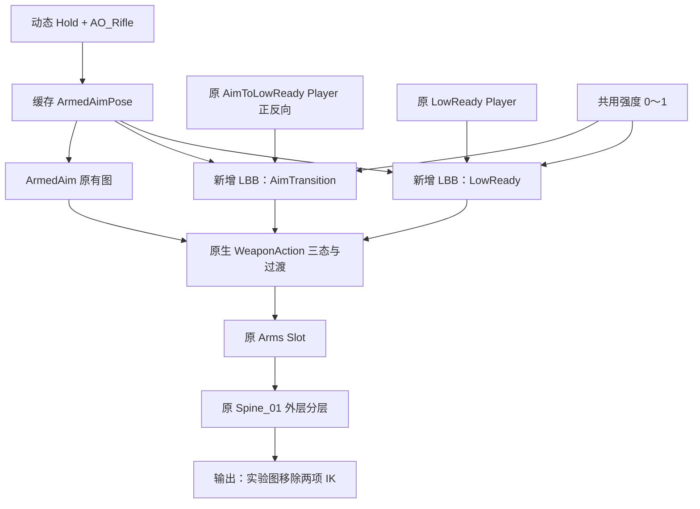

# Rifle 俯仰遮罩最小实验实施与验证

日期：2026-10-10。环境：UE 5.6.1。

## 结果与边界

已在既有隔离 AnimBP 中增加两处 LBB，共用一张实验遮罩和可调强度。
实验图的 Aim IK、左手 IK 节点已移除；原生三态、单 Player 正反向保留。
数值验证通过，头部恢复随俯仰变化，LowReady 枪械组件空间旋转保持基线。
枪械位置仍随父级变化，所列强度 1 样本最大偏移 3.34 cm。
因此本轮证明部分保留俯仰与低位方向可行，尚未实现严格固定枪械位置。
自然观感、持续变角和极端姿态仍需用户在隔离关卡中验收。

生产 AnimBP、Skeleton、Reload 遮罩、动画及运行模块保持原貌；不提交或推送。
首发提示词完整保存在本报告同批验证目录的 `首发提示词原文.txt`。

## 实际改动

资产均位于 `/Game/Experiments/RifleTransition`：

- 修改 `ABP_TP_RifleTransition_Test`：两个动作状态内部新增 LBB，各配缓存引用和强度 Getter。
- 新增 Skeleton 容器 `SK_RiflePitchMask_Test`，其中新建 `RifleLowReadyNaturalPitch` 遮罩。
- 保存原有 `L_RifleTransition_Test`：强度 1，IK 标志关闭，选择主实验副本。
  保留原 Actor 的目标、俯仰和位置；当前目标 ArmedAim、俯仰 0°。

仅修改既有 Editor 测试目录的三份源码：
`ShooterRifleTransitionFixture.h`、`.cpp` 和 `ShooterRifleTransitionTestCommandlet.cpp`。
增加浮点参数、运行中强度按钮和基线／实验取证入口；未新建源码文件。
未更改 Gameplay、复制、生产动画数据源或 IK 实现。

### 图与遮罩

两处 LBB 的 Base Pose 为原 Mixamo Player，Blend Pose 为真实动态 ArmedAimPose。

开启 Mesh Space Rotation Blend，关闭 Root Space Rotation 和 Mesh Space Scale Blend。
Curve Blend Option 使用 Base Pose，避免额外带入 ArmedAim 曲线。
ArmedAim 状态本身没有新增混合，Reload 遮罩和 Slot 路由未改。

| 骨骼 | 遮罩权重 |
| --- | ---: |
| spine_01 | 0 |
| spine_02 | 0.05 |
| spine_03 | 0.10 |
| spine_04 | 0.15 |
| spine_05 | 0.20 |
| neck_01 | 0.45 |
| neck_02 | 0.65 |
| head | 0.80 |
| clavicle、双臂及其余骨骼 | 0 |

只写入上述七个非零骨骼，不递归传播权重。全局强度乘以遮罩权重。
这些是验证起点，并非已经验收的生产权重。

遮罩由实验 Skeleton 承载，AnimBP Target Skeleton 仍是原 `SK_Mannequin`。
不复制网格或动画，不 Retarget，不向生产 Skeleton 添加遮罩。
实验 Skeleton 复制时保留原有配置，仅新建上述一张遮罩。
原 Skeleton 的 Mask 下拉菜单未必列出实验遮罩；当前跨容器引用已编译与实际求值验证。
查看权重应打开 `SK_RiflePitchMask_Test`，不要在原 Skeleton 上创建同名遮罩。

设计依据为已有专项审查和 [Epic Blend Masks 文档][epic-mask]。
官方说明 Mask 存在 Skeleton 中；本地 UE 5.6.1 的 `AnimationRuntime.cpp`
在 `CreateMaskWeights` 中支持 Skeleton 映射，LBB 编译校验允许本次引用。
本轮通过保存后重开和真实组件求值验证该安装版本的行为。

## 数值验证

基线是实施前原实验图、两项 IK Alpha 关闭时的真实 TP 输出。
每组创建独立预览实例，60 Hz 更新实际 SkeletalMeshComponent；不是静态动画抽帧。
五个俯仰为 -60°、-30°、0°、30°、60°，实验强度为 0、0.5、1。
每组 260 帧，经历 ArmedAim、收枪、LowReady、拔枪、短时收枪及中途反向。
实施前 1300 帧；实施后 3900 帧，每帧 89 个骨骼加枪械，共 351000 行。
导出 Local Quaternion、Component Quaternion、组件空间位置和状态／Player 数据。

- 强度 0 对比实施前：所有输出位置、局部及组件旋转差为 0，按 CSV 精度。
- 初始 ArmedAim 30 帧：所有强度与基线的位置、组件旋转差为 0。
- 各强度全部帧的状态、过渡 Player 时间及速率与基线一致。
- 中途反向：Player 时间从 0.416667 s 到 0.400000 s，速率从 +1 到 -1。
  没有重新从端点启动。

以下取各组第 100 帧的稳定 LowReady。头部列为相对本组平视的组件四元数夹角，
是无符号空间角差，不等同于 Euler Pitch。枪械位移和旋转均相对同俯仰、同帧强度 0。

| 强度 | 输入俯仰 | 头部角差 ° | 枪械位移 cm | 枪械角差 ° |
| ---: | ---: | ---: | ---: | ---: |
| 0 | 五个角度 | 0 | 0 | 0 |
| 0.5 | -60 | 18.33 | 1.66 | 0 |
| 0.5 | -30 | 10.59 | 1.12 | 0 |
| 0.5 | 0 | 0 | 0.43 | 0 |
| 0.5 | 30 | 17.55 | 0.30 | 0 |
| 0.5 | 60 | 30.60 | 0.45 | 0 |
| 1 | -60 | 37.38 | 3.34 | 0 |
| 1 | -30 | 21.41 | 2.26 | 0 |
| 1 | 0 | 0 | 0.86 | 0 |
| 1 | 30 | 35.08 | 0.59 | 0 |
| 1 | 60 | 61.51 | 0.91 | 0 |

上仰、下俯不对称，符合来源姿态并非对称分配的预期。
0° 也存在枪械位移，说明直接混入 ArmedAim 同时带入 Hold 基础姿态差异。
Mesh Space Rotation 保留零权重手臂的组件旋转，无法消除父级影响下的 FK 位置变化。

全段最大头部帧间角差在强度 0／0.5／1 下分别为 21.77°／13.05°／4.15°。
枪械最大帧间角差仍约 29.5°，与基线接近；这是原动作与过渡中的变化，不能宣称已平滑。
这些峰值包含完整动作和边界，不是专门的边界跳变验收阈值。
本轮不据此宣称所有边界无可见跳变；需要视口连续观察。

初始 ArmedAim 数值一致不等于全程返回姿态逐帧完全一致。
新 LBB 会持续消费动态缓存，可能推进 Hold 循环相位；原 ArmedAim 图保持原貌。
Reload／Fire 的生产资源和路径未改，本轮没有额外执行 Montage 行为回归。
CSV 测量对象为 TP 与 TP 枪械；没有把保留的 FP CopyPose 链路当作相机验收证据。

## 如何使用

1. 打开 `L_RifleTransition_Test`，回到关卡视口，在 Outliner 选择预览 Actor 本身。
   找到 Details 的 `Rifle Test` 分类；不要只选它的 Mesh 组件。
2. 确保 `Always Update Source Pose` 未勾选，使用本轮修改的主副本。
   另一份 AlwaysUpdate 实验 AnimBP 没有添加遮罩或删除 IK。
3. 开启视口实时更新（Ctrl+R）。也可使用 Simulate（Alt+S）观察连续播放。
4. 点击 `Toggle Rifle Test Goal` 收枪／拔枪；动画中再次点击验证中途反向。
5. 点击 `Cycle Rifle Test Pitch`，按 0、30、60、-30、-60 循环输入俯仰。
6. 点击 `Cycle Rifle Test Natural Pitch Strength`，在 0、0.5、1 间循环对比。
   初始强度为 1，第一次点击进入 0。按钮直接推送现有实例，不重建组件。

静止设置任意强度可编辑 `Rifle Test Natural Pitch Strength`，范围 0～1。
连续播放时优先使用按钮；编辑 Actor 属性可能触发 Construction，影响时间连续性。
实验图已移除 IK 节点，因此旧 `Rifle Test IK` 勾选框不能恢复这两项 IK。
三次强度按钮调用已在预览准备步骤验证，最终保存强度 1。
普通交互编辑器已重新打开，没有使用启动 Python 执行参数或截图回调。

优先从强度 0.5 对比 1：前者降低枪械位移，后者保留更明显的头部俯仰。
重点观察极端下俯、收枪／拔枪首尾，以及反向时头颈和枪械是否出现可见跳变。
本轮到此停止，后续权重调整或额外补偿等待授权。

## 验证、问题与证据

最终 Editor Target 编译成功，实验 AnimBP 编译 0 错误、0 警告并保存。
首次编译遇到 `SyncBlendMasksAndLayers` 为私有接口，已改为设置公开数组。
数值 Commandlet 正常退出，无错误；其警告包含环境证书和预览构造早期 Socket 检查，
不将这些警告描述为全绿。实验图读回确认两个新 LBB 引用同一 Mask，图中无两项 IK。
仅调整状态输出节点位置方便阅读，连线和运行逻辑不变。

实施前 905 份现有文件做 SHA256 快照，结束时 900 份原样。
仅两份实验资产和三份 Editor 测试源码变化；另新增实验 Skeleton。
生产 Skeleton、Reload Mask 所在包、生产 ABP、配置和历史报告均未变化。
源码 include 检查、本轮新增文本版式检查及 `git diff --check` 通过。
既有源码仅内容修改，不需要刷新 VS 工程文件。

运行证据在 `Saved/RiflePitchMaskExperiment/`：

- `before.csv`、`poses.csv`：实施前后真实输出。
- `summary.json`、`analyze.py`：四元数比较、反向及状态时间核对。
- `mask.t3d`、`live_final_graphs.json`：已保存遮罩和最终编辑器图读回。
- `protection.json`、`protected_before.json`：既有文件保护对比。
- `build_final.log`、`apply.log`、`measure.log`、`preview.json`：构建、保存和取证。
- `ABP_TP_RifleTransition_Test.before.uasset`：实施前主实验 ABP 备份，未装回 Content。

本报告验证目录保留首发提示词和精简证据；原始 CSV 未重复复制进 Docs。
完成后删除本轮临时进度文档，其他进行中计划文档保持原样。

[epic-mask]: https://dev.epicgames.com/documentation/en-us/unreal-engine/blend-masks-and-blend-profiles-in-unreal-engine?application_version=5.6
