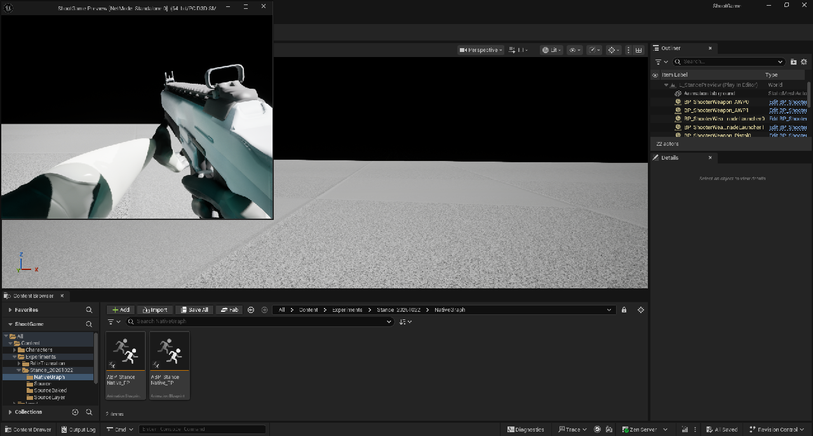
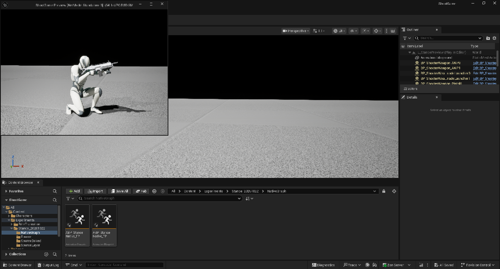

# Stance 原生动画图与八向／idle 验证

日期：2026-11-15；UE 5.8.4 工作树。
本轮完成实验自写 C++ 姿态链路的移除，并在原生 AnimBP 上重新测量。
八向接触质量与半蹲 idle 资源一致性尚未通过。

## 移除与保留范围

从实验 C++ 移除 Sample、BlendWalk、ComponentPose、LayerUpperBody、AimSpines、Grip、Limb。
同时移除手工动画制作、过渡姿态缓存、骨骼数组回写和旧 BlendSpace 取样。
不再使用 PoseableMesh、FCompactPose、EvaluateBoneTrackTransform 或 GetSamplesFromBlendInput。
旧 C++ 制作模式和 LegacyLower 回退入口均退役，不以开关保留旧运行链路。

C++ 保留输入、Actor 移动、相机、只读实际骨骼采集及 Editor 资产建图。
Editor 建图只配置引擎节点、引脚和资产引用，不采样或写入动画轨道。
只读采集允许读取原生播放器时间与最终 SkeletalMesh 骨骼，不驱动播放器时间。
没有自定义 AnimInstance、动画代理或自定义 AnimNode 执行姿态计算。

实验 Actor 移动改为固定 150 cm/s，退出旧来源行进量／混合权重速度推导。
本轮接触采集使用 Stationary，避免把 Actor 速度当作脚部高度原因。
该固定速度未做步幅匹配，本轮不宣称移动脚滑通过。

## 原生动画资产

新增目录 /Game/Experiments/Stance_20261022/NativeGraph，仅两个 AnimBP：

- ABP_StanceNative_TP：标准 Engine.AnimInstance 父类。
- ABP_StanceNative_FP：标准 Engine.AnimInstance 父类，只有 Copy Pose 和 Output。

TP 数据由 BlueprintUpdateAnimation 读取实验 Pawn 的标量输入。
序列和 BlendSpace Player 原生播放；Blend by Int 处理站立、idle、移动、滑铲。
原生状态混合及 Cached Pose 负责过渡，不再由 C++ 逐骨插值。
上半身使用生产 Rifle Aim／Compact LowReady 和 Mesh Space Additive AO_Rifle。
Layered Blend Per Bone 配置为 spine_01、depth=1、Mesh Space Rotation。
L 开关通过原生 Blend by Bool 输出仅下半身或完整分层。

FP 原生 Copy Pose 从附着父 Body 复制，附加 Tick prerequisite 保证源先求值。
两网格关闭额外 PostProcess AnimBP，保持本实验求值范围清晰。
实验没有使用生产自定义 ShooterAimIK、ShooterLeftHandIK 或 Control Rig。
生产的这些节点及其代码完整保留，没有修改正式角色的动画路径。

现有 SourceLayer 的六段、BlendSpace、完整 SourceBaked 和旧 92 段均保持原样。
原滑铲仅作为现成序列播放；没有重做滑铲或保留其旧 C++ 制作功能。
地图资产仍是原地图，默认实验 Pawn 组件和运行代码已更新。

[磁盘重载与节点白名单](Verify.json)。
[生成图节点](GraphNodes.csv)与[真实连线](GraphLinks.csv)。
[可见编辑器实际图读取](EditorGraphAudit.json)确认分层、AO 和 FP Copy Pose 配置。

## 运行检查

相同固定时间步长下运行两次：完整分层、仅下半身。
每次覆盖 18 场景：两种持枪 idle，加八方向 × 两种持枪。
idle 每场景 14 秒，覆盖超过两个 6.7 秒来源循环。
移动每场景 4 秒，排除前 0.6 秒过渡后统计。
每三帧读取一次实际组件，采样频率约 20 Hz。

每次 1,840 个采样帧，Body 89 根骨骼，共 163,760 组 TP 骨骼帧。
同时读取等量 FP，两个运行总计 655,040 组实际骨骼帧。
记录世界／组件位置、旋转、原生 idle 时间、BlendSpace 相位及有效时长。
数据来自 SkeletalMesh 已完成求值的骨骼；没有调用自写姿态求值代替实测。

- FP／TP 世界位置最大差：0 cm。
- FP／TP 组件旋转最大差：0.00000342°。
- 仅下半身／完整分层的稳定下半身位置最大差：0 cm。
- 下半身旋转最大差：0.00000342°。
- 腿部骨长最大误差：0.000001315 cm。

[实际运行对照结果](Layered.native.json)。
[完整分层原始数据](Layered.csv.gz)与[仅下半身原始数据](Raw.csv.gz)。
二者都是原生 AnimBP 的真实运行，不是旧 C++ 与新链路混用。

## 八向接触结果

下表合并 Aim／LowReady，取两次姿态中最低前掌。
穿地帧指任一 foot／ball 骨骼低于地面 1 cm，不含过渡。
每方向有 136 个稳定采样帧。

| 方向 | 最低前掌 cm | 穿地帧 |
| --- | ---: | ---: |
| 前 | -3.828 | 62 |
| 右前 | 0.489 | 0 |
| 右 | 0.549 | 0 |
| 右后 | -16.393 | 98 |
| 后 | 0.224 | 0 |
| 左后 | -7.043 | 64 |
| 左 | 0.583 | 0 |
| 左前 | 0.371 | 0 |

右后、左后、正前在原生 BlendSpace Player 上仍复现明显穿地。
Raw／分层的下半身一致，排除了当前上半身分层造成这些高度变化。
资源与骨架保持，骨长正常，也没有 C++ 接地或额外腿部求解介入。

新播放器的时间调度、采样密度与旧版不同。
右后 -16.393 cm 与上轮 -17.162 cm 不能直接解释为取消代码后改善了约 1 cm。
关键结论是严重穿地仍能在原生链路独立复现。

已有样本没有独立正前、左后、右后来源动作，仍为稀疏方向混合。
前后制作记录中来源接触方式和同进度姿态差异仍然存在。
后续应在原生路径下补齐合适方向、匹配左右脚接触相位。
本轮未把相位偏移当作已完成的修复，也未重新制作来源动画。

未穿地的骨骼点采样不等于完整鞋底平贴或移动自然度通过。
本轮没有鞋底逐顶点测量、地面 Trace、坡面或台阶适配。

## 下蹲 idle

原始 idle 前掌没有明显穿地，但它是单膝跪姿：

- 骨盆：38.870～39.118 cm。
- 右膝 calf_r：5.823～5.952 cm。
- 左膝 calf_l：47.001～47.162 cm。
- 左前掌最低约 0.994 cm，右前掌最低约 0.603 cm。

半蹲移动骨盆约 63.188～75.426 cm。
因此，当前 idle 与半蹲行走不是同高度、同类型的动作。
原生过渡节点只能混合姿态，不能把跪姿自动变为匹配移动的半蹲 idle。

后续应制作或选择与移动骨盆高度、膝盖朝向和支撑关系匹配的半蹲 idle。
原始跪姿来源继续保留，不能通过 C++ 抬骨盆或迁移肩部伪装成另一动作。
本轮只确认资源类型和高度差，不宣称完成新的 idle 制作。

[逐方向与 idle 汇总](Findings.json)。

## 构建、保护和排错

构建使用 -UsePrecompiled -NoEngineChanges，BuildV3 通过。
源码变更仅在原 Stance 两个文件；未新增、删除或移动 C++ 文件。
不需要刷新 VS 工程，未操作 VS。
include、文本版式、Python／PowerShell 语法与差异检查见 Checks.json。
检查使用独立临时 Git 索引，真实暂存区不变，未创建提交。

174 个既有保护文件保持字节不变，包含正式动画、骨架、地图及 Blender／FBX 输入。
[保护清单](Protection.json)。

首轮编译发现本地 API 为 Blueprint.GetAllGraphs、组件公开 setter。
修正后构建通过，不访问 private 字段。
首轮建图连接使用 MakeLinkTo，未触发 Cast 输入类型推断，编译拒绝保存。
改用 Schema.TryCreateConnection 后两个图完整编译并保存。
失败建图未覆盖旧资产。

Python 直接读取 ParentClass／Nodes 遇到保护属性限制。
改用 BlueprintEditorLibrary 与 BlueprintGraphEditor 的公开查询接口。
独立重载审计和可见编辑器官方 MCP 的实际节点读取均通过。
没有修改引擎或降低节点白名单标准。

## 验收入口

可见 UE 5.8 编辑器恢复原实验地图，并以 PIE 启动新链路。
WASD 试八向；松开回来源 idle；V 切视角；R 切持枪；L 对照原始下半身。
1 站立，2 idle，Space 原滑铲，T 暂停，O 八向轮换。
旧资源说明中的制作命令属于之前夹具；当前入口以现状文档为准。

[窗口状态](ReviewWindow.json)、[完整性清单](Manifest.json)。
本轮没有生产角色接入、网络、碰撞、换弹、贴墙、Cook 或滑铲整套回归。
没有借此宣称生产 AimIK、左手 IK 或完整角色动画链路已经复刻。

## 外部依据与本地对照

Epic 官方说明支持 AnimBP 的 BlendSpace、Mesh Space Additive AimOffset、
Layered Blend Per Bone 和 Copy Pose From Mesh。
生产图通过官方 MCP 只读核对了 AO_Rifle、spine_01／depth=1 和父网格 Copy Pose。
新实验复用这些原生节点的职责，排除生产自定义 IK 以满足本轮范围。

官网内容当前展示 5.8／5.9 混合版本，本地安装的 UE 5.8 API 已逐项核对。
BlueprintGraphEditor 的公开列表接口与本机官方 MCP 实现一致。
本地事实不等于通用推荐，本文仅说明本实验采用的可验证路径。

[AimOffset 官方说明](https://dev.epicgames.com/documentation/en-us/unreal-engine/aim-offset-in-unreal-engine)。
[Blend 节点官方说明](https://dev.epicgames.com/documentation/unreal-engine/animation-blueprint-blend-nodes-in-unreal-engine)。
[Copy Pose 官方说明](https://dev.epicgames.com/documentation/en-us/unreal-engine/copy-a-pose-in-unreal-engine)。
