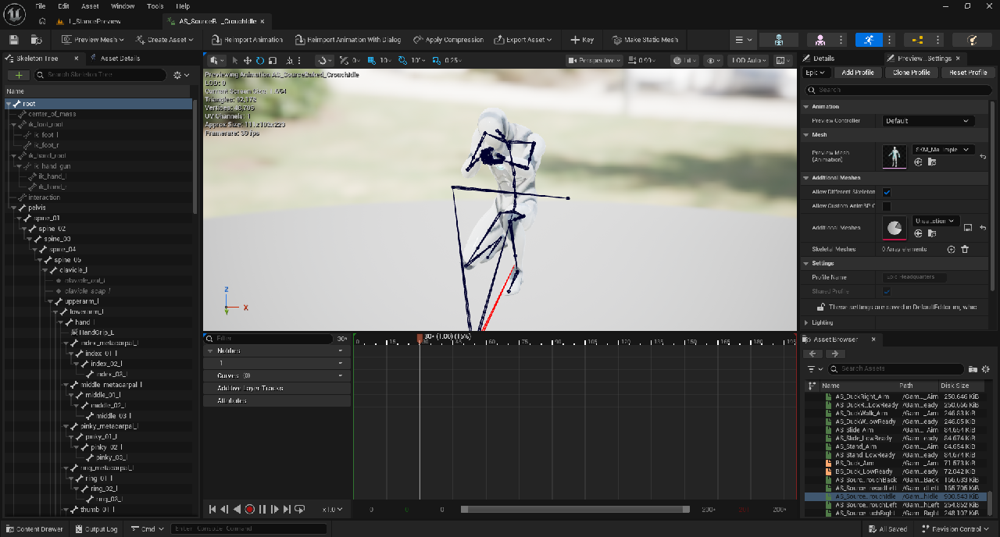

# 原始下蹲父层烘焙与生产 Skeleton 验证

日期：2026-11-15；环境：UE 5.8 工作树、Blender 4.5.8 LTS。
本轮完成五段独立导入版本，保留原始 Source 与当前实验。
新增动画直接绑定生产骨架，无须增加兼容骨架名单或修改骨架参考姿态。

## 原因与实现

原始 FBX 在骨架对象 SKM_Manny_Simple 上保留了父层运动。
真实 root 下的骨骼层级与生产 Manny 匹配，但只读取骨骼轨道会遗漏父层。
Blender 中逐帧计算对象与骨骼组合变换，将父层运动烘焙到真实 root。
仅归一化固定的默认参考坐标，保留初始 XY、朝向和水平净位移。
静态对象命名 Armature，使用标准 FBX 动画导出和 UE FbxFactory 导入。

Expected.json 直接解析原始 FBX 得到全骨骼姿态，作为独立核对基准。
它不作为 UE 动画轨道写入输入。
本轮未重新制作步态、接地、握持或循环，也没有新增 C++ 修正。

## 新增资产

目录：/Game/Experiments/Stance_20261022/SourceBaked。

| 动画名后缀 | 帧数 | 时长（秒） |
| --- | ---: | ---: |
| CrouchIdle | 202 | 6.7 |
| CrouchLeft | 38 | 1.233333 |
| CrouchRight | 37 | 1.2 |
| CrouchBack | 31 | 1 |
| CrouchForwardLeft | 31 | 1 |

资产前缀为 AS_SourceBaked_，五段均为 30 fps。
Skeleton 为 /Game/Characters/Mannequins/Meshes/SK_Mannequin。
预览 Mesh 为 /Game/Characters/Mannequins/Meshes/SKM_Manny_Simple。
原始 89 根动画骨骼不等于生产 Skeleton 的全部 161 根骨骼都有轨道。
缺少的生产辅助骨骼沿用骨架默认行为，不虚构额外源轨道。

稳定制作输入位于 SourceAssets/StanceCrouch/ParentBaked。
包含五份 blend、五份 FBX、Expected.json 与 BakeSummary.json。
保存的导入源路径指向该目录，不依赖 Saved 候选目录。

## 数据验证

Blender 源导入与直接解析原始 FBX 对照：

- 最大位置误差：0.000546 cm。
- 最大旋转误差：0.001017°。
- 烘焙前后最大位置误差：0.000055 cm。
- 烘焙前后最大旋转误差：0.000046°。

先用生产 Skeleton 副本 Probe，验证后删除临时目录且不保存副本。
随后五段绑定实际生产 Skeleton，全部通过后仅保存新增动画。
导入前后生产骨架的参考姿态及平移重定向模式一致。

独立命令行进程重新从磁盘加载，覆盖 339 帧 × 89 骨骼。
共 30,171 组骨骼帧，分别检查 RAW / COMPRESSED，结果均通过。
这些数据来自 UE 实际动画求值，不以截图代替骨骼检查。

- 最大组件空间位置误差：0.002616 cm。
- 最大组件空间旋转误差：0.009557°。
- 对照旧 Source，非 root 局部位置最大差：0.002647 cm。
- 对照旧 Source，非 root 局部旋转最大差：0.009604°。

非 root 对照用于证明肢体动作保持原样，root 则恢复遗漏的父层运动。
idle 的 root Z 约为 -42.427～-41.754 cm，保留原始下蹲运动。
各段原始水平位移范围见 Verify.json；本轮没有转换为原地动画。

124 个既有文件的 SHA-256 前后相同。
范围包含原始 FBX、旧 Source、既有实验动画、地图及生产保护资产。
动画窗口打开后再次核对，结果仍一致，见 Protection.json。

## 证据入口

- [Blender 求值与烘焙](BakeSummary.json)。
- [副本预检](Probe.json)与[实际导入](Import.json)。
- [磁盘重载与逐帧汇总](Verify.json)。
- [既有资产保护](Protection.json)。
- [实际骨骼数据，gzip CSV](RawBones.csv.gz)。
- [可见窗口交付状态](ReviewWindow.json)。
- [完整性清单](Manifest.json)。

截图只辅助确认预览 Mesh 和可见窗口，不作为姿态保真或接地通过证据。
编辑器通过正常启动后使用官方 MCP 打开新 idle 动画。
验收时保留单个可见 UE 5.8 编辑器。

## 排错与边界

首次候选将原始 FBX 默认 T 姿态与旧工具 A 姿态的全局位置直接比较。
这个检查出现约 72.519 cm 差异，流程中止且未导入 UE 资产。
修正为骨长匹配及原始 FBX 的实际世界姿态对照后，CandidateV2 通过。
没有用 A 姿态补偿去改写原始动作。

首次预览使用 -ExecutePythonScript 启动，脚本后发生自动 QUIT_EDITOR。
该次退出又触发关闭超时崩溃；日志保留于 ReviewEditor.log。
后改为正常可见启动，再用 MCP 打开动画，当前窗口持续运行。
正常启动日志为 ReviewEditorNormal.log；未据此修改引擎或动画。

当前地图、两套 BlendSpace 与已有 92 段派生动作未替换。
本轮没有验证这些原始动作直接用于分层时的握持、脚掌或循环自然度。
没有运行 PIE、生产 AnimBP、网络、Cook 或全套回归。
本轮仅增加离线动画及 Python 工具，未修改 C++，无需编译和刷新 VS 工程。

## 实现依据

Epic 要求动画导入选择匹配的现有 Skeleton：
[FBX 动画流程](https://dev.epicgames.com/documentation/unreal-engine/fbx-animation-pipeline-in-unreal-engine)、
[导入 FBX 动画](https://dev.epicgames.com/documentation/unreal-engine/importing-animations-using-fbx-in-unreal-engine)。

本地 UE 5.8 FbxMainImport.cpp 中 Blender Armature 容器跳过逻辑已核对。
本工作树实际使用 UE 5.8，本轮没有将 UE 5.6 行为假定为相同。
原项目旧 Source 使用克隆骨架且遗漏父层运动，本次通过独立版本验证直接绑定。
