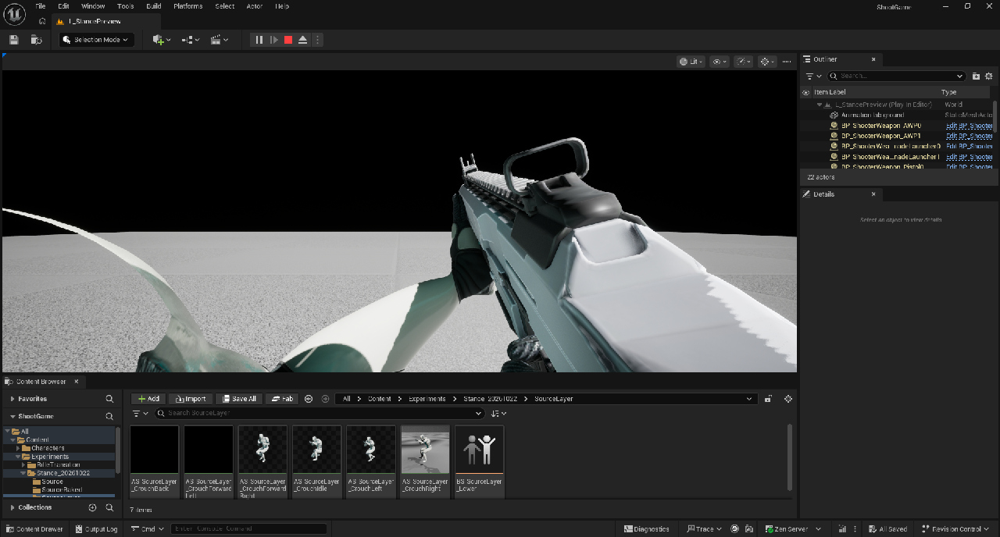

# 新来源下半身替换实验分层

2026-11-15，UE 5.8.4 工作树。
实验默认下半身已切换到新来源的原地派生资源。
上半身沿用既有 spine_01、depth=1、Mesh Space Rotation 分层及瞄准、握持处理。
本轮完成替换与数据核对，脚掌接触和混合自然度未通过。

## 资源和输入

新增 /Game/Experiments/Stance_20261022/SourceLayer：

- 六段 AS_SourceLayer_ 动画：idle、左、右、后、前左、前右。
- BS_SourceLayer_Lower：中心 idle 与五个移动样本。
- Aim / LowReady 共用下半身，上半身仍由原站立持枪姿态提供。

完整 SourceBaked 的五段、原始 Source、旧 92 段及旧 BlendSpace 均保留。
SourceAssets/StanceCrouch/LayerPlayback 保留六份 blend、FBX 和验证输入。
正式 Skeleton、正式 AnimBP 与地图资产没有改写。
实验默认选择由 Editor 夹具代码控制，地图不需要另存或替换 GameMode。

Blender 仅移除移动片段每循环的净 XY 行进。
保留 root 的高度、原始偏航及周期摆动，不逐片段归零偏航。
idle 原始运动保持，前右由前左镜像并错开半周期补齐。
五段非镜像动作的非 root 轨道未重新制作。
没有执行接地、腿部 IK、鞋底校平或脊柱、手臂的新制作。

原始序列时长保留，现有混合器仍按归一化相位采样。
本轮移动共同周期为前左的 1 秒；idle 为原始 6.7 秒。
前、后斜向等缺少独立来源的方向通过稀疏样本混合及边界投影得到。
它们不等于新增了原生八向动作，也未证明接触时序兼容。

## 移动速度匹配

旧实验按制作后的短步幅使用约 50.35 cm/s 固定速度。
新原始动作每循环移动 121～206 cm，直接沿用旧速度会额外滑步。
最终从完整 SourceBaked 只读提取每循环水平行进量。
按当前 BlendSpace 权重及共同周期求速度，再投影到当前输入方向。
只改变 Pawn 移动，不改骨骼、地面高度或足部姿态。

直接来源方向的速度约为：

- 左移：137.341 cm/s；右移：121.262 cm/s。
- 后退：205.724 cm/s。
- 前左、前右：205.723 cm/s；正前混合约 145.469 cm/s。

从实际 Body 的世界与组件骨盆变换独立重建 Actor 平面速度。
12 个直接来源场景核对通过，最大速度误差 0.05355 cm/s。
固定采集的 Actor yaw=0、Mesh yaw=-90；此重建不宣称覆盖任意 Actor 朝向。
见 [MovementMatch.json](MovementMatch.json)。

## 资源数据验证

标准 FbxFactory 导入，直接绑定生产 SK_Mannequin。
副本 Probe 通过并清理，实际导入前后骨架参考姿态及重定向模式一致。
独立进程从磁盘重载，覆盖 370 帧 × 89 骨骼，共 32,930 组骨骼帧。

- RAW / COMPRESSED 最大位置误差：0.002438 cm。
- RAW / COMPRESSED 最大旋转误差：0.009122°。
- 非镜像动作对照完整源，非 root 局部位置最大差：0.000627 cm。
- 非 root 局部旋转最大差：0.002463°。
- 移动片段残余净 XY 行进低于 0.00003 cm。
- Blender 最终烘焙位置误差低于 0.000045 cm，旋转低于 0.000892°。

[资源重载汇总](Verify.json)、[标准导入](Import.json)、[副本预检](Probe.json)。
[Blender 实际求值](BakeSummary.json)。

## 实际运行骨骼

Ground 采集包含 16 方向、两种持枪状态、完整 idle 及六个压力场景。
共 40 场景、7,511 帧，记录实际 Body 求值后的骨骼及参考接触点。
独立 UE 动画求值再对照 idle 和五个直接来源方向的两种持枪状态。
核对 359 帧、3,231 组骨骼帧通过。
最大位置差 0.01304 cm，旋转差 0.01449°。
场景日志列出新 BlendSpace 和六段真实输入路径，不依赖截图推断引用。

View 采集覆盖 108 个俯仰、朝向和姿态场景，共 2,160 采样帧。
新采集同时记录 root、双腿及上半身，共 26 骨骼。
16,220 组稳定下半身骨骼帧中，raw→layer→实际 Body 的变换差为零。
这证明当前上半身处理未改写实际下半身。

完整上半身相对相机的几何与替换前一致，站立姿态也一致。
FP 与本帧最终 Body 位置差为零，最大旋转差约 0.00000342°。
旧 View 只采上半身及 pelvis，不能据此声称逐骨比较了旧双腿。
新双腿的输入正确性由 RuntimeInput.json 的独立源动画对照证明。

[实际输入匹配](RuntimeInput.json)、[阶段不变性](LayerRuntime.json)、
[FP／TP 及持枪几何](AfterView.summary.json)。

## 脚掌与自然度边界

本轮按原始动作试换，接触质量没有达到旧步态的门禁。
以下值来自现有参考鞋底点与实际骨骼，不是鞋底网格碰撞或地面 Trace。

| 指标 | 旧步态 | 新动作、旧速度 | 新动作、匹配速度 |
| --- | ---: | ---: | ---: |
| 稳定最低参考接触点 cm | 0.197 | -17.162 | -17.162 |
| 稳定双脚均离地超过 1 cm 的帧数 | 0 | 198 | 198 |
| 整体支撑脚滑 P95 cm/s | 0.044 | 155.592 | 48.585 |
| 最差场景脚滑 P95 cm/s | 0.079 | 227.004 | 121.394 |

速度匹配减少了行进速度不一致造成的滑步，没有修复接触高度或混合时序。
部分直接来源方向最低接触约 -0.2 cm，严重问题集中于部分混合方向。
前左及其镜像来源本身也存在接触间隙，不能把全部问题归因于插值。
腿部骨长误差仍低于 0.000002 cm，不是骨长缩放或新增 C++ 接地造成。
当前结果是可试走的原始动作分层对照，不能标记为贴地或自然度通过。

[旧步态](Before.summary.json)、[速度未匹配](UnmatchedSpeed.summary.json)、
[最终新步态](After.summary.json)保存完整逐场景统计。
后续应优先核对缺少方向的来源动作、左右脚相位及混合兼容性。
需要改善接触时仍应在 Blender 制作资源，本轮没有回填 C++ 接地修正。

## 试走和对照

可见 UE 5.8 编辑器已打开 L_StancePreview 并启动 PIE。
2 为新来源 idle；WASD 移动；V 切视角；R 切 Aim / LowReady。
1 为原站立，Space 为原滑铲；按 Esc 停止 PIE。

~~~powershell
& './Scripts/Animation/Stance/Run.ps1' -Mode Preview
& './Scripts/Animation/Stance/Run.ps1' -Mode Preview -LegacyLower
& './Scripts/Animation/Stance/Run.ps1' -Mode Verify
& './Scripts/Animation/Stance/Run.ps1' -Mode Verify -LegacyLower
~~~

命令行 -StanceLegacyLower 也可选择旧下半身，默认采用新版本。
ApplyResources 仍只更新旧 92 段，不覆盖新 SourceLayer。

## 排错、保护及验证范围

首轮分层导出重建全局矩阵时误用单位尺度。
关闭重定向时误差很小，启用生产骨架重定向时位置误差约 1661 cm。
Probe 阻止保存并清理副本；保留原 Armature／骨骼尺度后两种求值均通过。
失败证据见 FailedScale.Probe.json，最终来自 CandidateV3。

第一次运行沿用旧速度，确认新腿部输入正确，但滑步严重。
随后仅适配 Actor 移动速度，并重采 Ground、View 和输入匹配证据。
分析器也修正了旧 View 缺少双腿通道的假设，不把 Actor 行进误作腿部变形。

项目 Editor 构建使用 -UsePrecompiled -NoEngineChanges，结果通过。
源码 include、Python 语法、PowerShell 语法及暂存范围文本检查见 Checks.json。
使用临时 Git 索引，实际暂存区保持空白；未创建提交。
没有新增、删除或移动 C++ 文件，不需要刷新 VS 工程。

142 个既有保护文件的 SHA-256 保持不变，见 Protection.json。
Sample、AimSpines、Grip、LayerUpperBody 函数逐字未变。
夹具改动限于新资源装配、选择、相位周期、Actor 速度及采集通道。

没有验证正式生产 AnimBP 接入、网络、坡面、台阶、碰撞、Cook 或整套滑铲回归。
实验依旧没有复制和 CharacterMovement，不影响网络权威逻辑。
当前上半身仍为既有实验实现，未借本轮宣称完成生产动画链路复刻。

## 证据与外部依据

原始运行 CSV 以 gzip 保存，Before／After 为最终对应版本。
UnmatchedSpeed 为排错中间版本，不能代替最终证据。
[夹具范围审计](FixtureChangeAudit.json)、[窗口状态](ReviewWindow.json)、
[检查结果](Checks.json)、[完整性清单](Manifest.json)。

Epic 的 BlendSpace 文档说明按样本输入权重混合，镜像文档说明左右骨骼映射。
本轮在 Blender 离线烘焙镜像，没有新接 UE Mirror 节点或 Mirror Data Table。
官网当前页面展示 5.9；5.8 定向页未能访问。
本地 UE 5.8 BlendSpace.h 的 API 与实际运行已核对，未把官网版本当作本地签名证明。

[BlendSpace 官方说明](https://dev.epicgames.com/documentation/en-us/unreal-engine/blend-spaces-in-unreal-engine)。
[动画镜像官方说明](https://dev.epicgames.com/documentation/en-us/unreal-engine/mirroring-animation-in-unreal-engine)。
