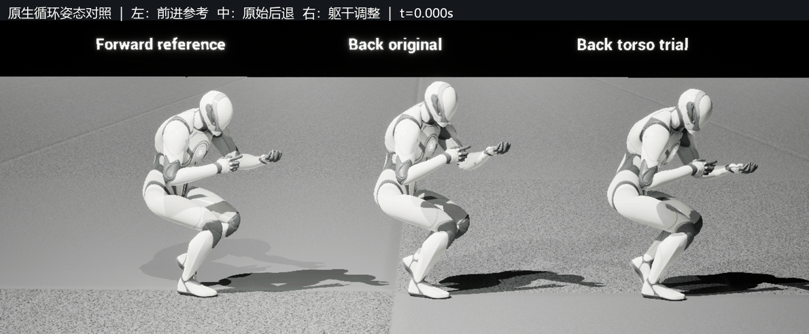

# 后退动画的局部躯干姿态参考实验

日期：2026-11-22。工程：ShootGame_UE58。分支：codex/ue-5.8。
本轮只制作一段独立后退派生，等待用户人工验收。

## 可见预览

地图：/Game/Experiments/Stance_20261022/L_BackTorsoReference。

进入 PIE 后，三个角色自动循环播放，左至右分别为：

- Forward reference：原始前进，仅作身体姿态参考。
- Back original：原始后退。
- Back torso trial：本轮后退派生。

三个角色采用同一 Manny Simple、Skeleton、地面高度、相机和一秒循环。
角色在地面并排摆放；没有为图片分别抬高、缩放或对齐身体。
这是固定位置的姿态对照，不是实际位移或正式 Gameplay。
可用编辑器暂停、单步与 F8 检查；此地图没有 WASD 角色移动。

## 本轮新增资产

全部位于 /Game/Experiments/Stance_20261022 根目录：

- AS_Back_TorsoReference：原始后退副本，局部修改六条旋转轨道。
- L_BackTorsoReference：独立三人对照地图。
- BP_BackTorsoComparisonMode：原生 GameModeBase 的最小配置副本，不生成默认 Pawn。

原 L_BakedEight_Crouch、BS_BakedEight_Crouch、AnimBP 与八段已验收动画不替换。

## 修改方式与依据

读取原始前进、后退的完整原生 Raw 姿态；骨盆平均高度仅差约 0.04 cm。
因此没有移动 Root、骨盆、角色或相机去压低人体。
对比完整循环的局部旋转，取前进与后退在局部 Z 轴上的平均转角差。
只把这个恒定差值施加到后退原有旋转上，不复制前进的逐帧运动。

| 骨骼 | 局部 Z 轴附加旋转 |
| --- | ---: |
| spine_01 | +1.551597° |
| spine_02 | +3.105237° |
| spine_04 | +3.105248° |
| spine_05 | +3.105240° |
| neck_01 | −4.057894° |
| neck_02 | −3.876731° |

使用 q_new(t) = q_back(t) × q_offset；偏移在整个循环中不变。
四段脊柱增加俯身，颈部配合调整，避免把整条头颈链一起向下压。
未修改 spine_03、head、肩臂、骨盆或双腿轨道。
手部组件空间位置会随胸部改变；本轮没有手部 IK 或武器适配。

复制源序列后，通过原生 AnimationDataController 写入上述六条轨道。
保留原序列 30 Hz、31 个关键点、一秒时长、全部平移与缩放。
输出仍为普通绝对姿态序列，没有新运行时节点或 C++ 骨骼算法。
EnableRootMotion 和 ForceRootLock 均保持 false。
这是 UE 内的离线轨道调整，不是新的 FBX 导入或 Blender 动作重制。

Epic 官方的动画层编辑资料支持在既有动作副本上做局部骨骼姿态调整。
本轮没有照搬其旧模板示例；实际调用以本机 UE 5.8.4 API 为准。
已核对 AnimPose.cpp 的 SetBonePose 会用原生逻辑更新组件空间姿态。
实际写轨道及求值 API 也已在本机运行验证。

[官方动画层编辑说明](https://dev.epicgames.com/documentation/unreal-engine/editing-animation-layers?application_version=5.8)

## 原生数值验证

三个序列分别执行 Raw、Compressed 两类原生求值，每类各采 121 个时间点。
下表为 Compressed 组件空间高度；均值排除重复的循环终点。

| 指标 | 前进参考 | 原始后退 | 派生后退 |
| --- | ---: | ---: | ---: |
| 骨盆平均高度 cm | 65.15 | 65.19 | 65.19 |
| 胸部平均高度 cm | 105.06 | 107.70 | 105.93 |
| 头部平均高度 cm | 117.90 | 123.47 | 119.54 |
| 头部循环起伏 cm | 3.56 | 3.70 | 3.82 |

派生头部平均下降约 3.92 cm；与前进的高度差由 5.56 缩至 1.64 cm。
没有为了清零差值继续调整，也没有强行压平身体起伏。

Raw 验证结果：

- 全部骨骼的局部平移、缩放差异为 0。
- 未编辑骨骼的局部旋转差异为 0。
- Root、骨盆、双腿、双脚、脚掌的组件位置和旋转差异为 0。
- 六条修改轨道的恒定旋转偏移误差最大约 0.000022°。

Compressed 验证中上述下半身位置差异也为 0。
脚掌骨最低高度仍为约 0.22482 cm；这是骨骼数据，不等于鞋底检测。
派生头部循环首尾位置差约 0.000079 cm，未发现明显新增循环断点。

真实 PIE 播放另采 130 帧、2.15 秒，覆盖两次完整循环。
原始后退与派生后退的播放相位完全一致。
运行时下半身位置差最大约 3.18e-14 cm，属于浮点舍入。
数据见 Summary.json、Verification.json.gz 与 LiveFrames.json.gz。

## 视觉证据与观察

动图来自 24 个等间隔原生播放相位，按一秒循环排列，不是实时录屏。
每次改变相位后等待四次 Slate Tick，再核对实际播放位置和组件骨骼。
另保留 0、0.25、0.5、0.75 秒的原始 PIE 窗口截图与骨骼数据。
没有按角色单独裁切、抬高或重新排列姿态。

固定相位画面中，派生版腰背更前倾，头颈高度更接近前进。
原始后退与派生版的腿脚排列一致，没有因本轮躯干处理新增挤脚现象。
躯干变化分布在多段脊柱，未见明显单节折弯；自然度仍等待人工验收。

## 边界与未解决项

- 没有把派生动画接入八向 BlendSpace，未测试转向上拱是否降低。
- 没有处理右后或其他方向，也未统一八段动作的身体基准。
- 鞋面接地和脚滑的原有问题没有修复；保留脚骨轨迹不能代表鞋面通过。
- 手部随胸部改变，左手平均高度约下降 9.64 cm，右手约下降 6.38 cm。
- 没有接入实际枪械、WeaponAction、AimOffset 或 IK，不代表持枪表现通过。

## 排错与证据保护

首次搭建新场景时，Rotator 的位置参数被解释成 Pitch，导致角色侧倒。
已改为明确的 pitch、yaw、roll 命名参数；这是新场景配置问题。
另一次截图误取编辑器主窗口，已转入 Saved 中的 RejectedEditorShots。
最终证据全部直接指定 PIE 窗口获取，并核对骨骼相位。
动画副本的有效性不依赖这些失败画面。

原始动画、Skeleton、已有实验资产、Source、Config 和原始输入的保护结果见 Protection.json。
没有建立分支、提交、更改生产系统或改写历史报告。
本轮只到独立后退候选和对照交付为止。
