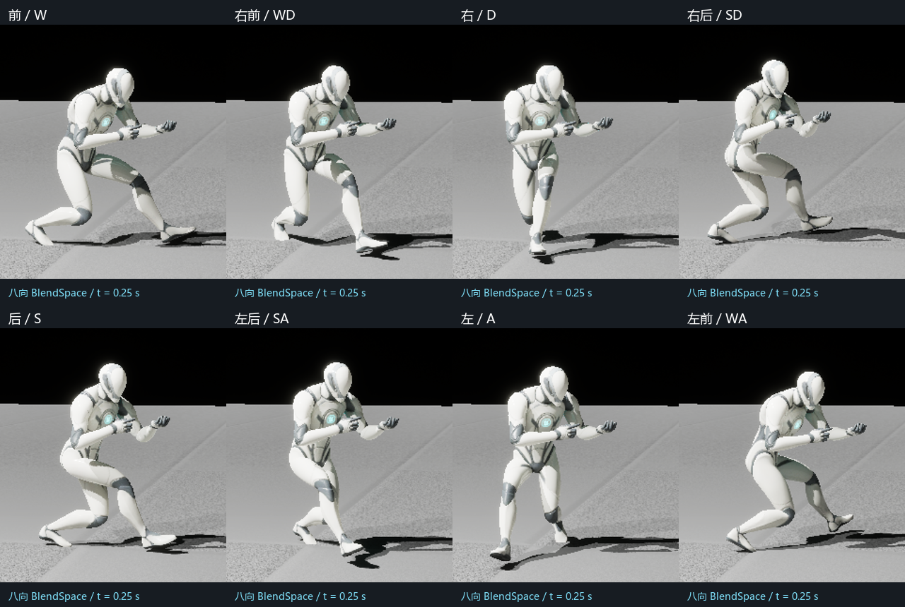

# 八段下蹲动画的原生 BlendSpace 接入实验

日期：2026-11-21。工程：ShootGame_UE58。原分支：codex/ue-5.8。
只接入四段主方向与四段已制作斜向，不修改动画轨道或生产系统。

## 可直接体验的入口

地图：/Game/Experiments/Stance_20261022/L_BakedEight_Crouch。

当前可见 PIE 已打开该地图，可以直接使用：

- W / S / A / D：前、后、左、右。
- WD / SD / SA / WA：右前、右后、左后、左前。
- 松键：停止位移并停在最后动画姿态。
- 鼠标：观察方向；V：视角；T：暂停。

没有制作或混入 Idle，没有用中心样本代替停止。
这仍是实验 Pawn 的预览，不是正式 CharacterMovement、Gameplay 或多人网络验收。

## 新资产

五项全部在 Stance_20261022 根目录：

- BS_BakedEight_Crouch：原生 2D BlendSpace。
- ABP_BakedEight_Crouch：最小播放图。
- BP_BakedEightGameMode：从启动直接选择新 AnimClass。
- BP_BakedEightPreview：复用原预览初始化和 Tick 前置关系。
- L_BakedEight_Crouch：现有 Stance 地图的独立副本。

原 L_OWLocalMovement、ABP_OWLocalMovement 和其余历史实验均保留。
新地图没有先播放旧图再在 Tick 中临时切类。

## 八个实际样本

横轴 Forward，纵轴 Right，范围 −1～1，保持原 Pawn 的 L1 方向归一化。

| 方向 | Forward | Right | 实际序列 |
| --- | ---: | ---: | --- |
| 前 | 1 | 0 | AS_RootLockSource_Forward |
| 右前 | 0.5 | 0.5 | AS_BlendBaked_ForwardRight |
| 右 | 0 | 1 | AS_RootLockSource_Right |
| 右后 | −0.5 | 0.5 | AS_OWBaked_BackRight |
| 后 | −1 | 0 | AS_RootLockSource_Back |
| 左后 | −0.5 | −0.5 | AS_BlendBaked_BackLeft |
| 左 | 0 | −1 | AS_RootLockSource_Left |
| 左前 | 0.5 | −0.5 | AS_OWBaked_FrontLeft |

所有序列绑定现有 SK_FourDirection，时长一秒，样本 RateScale=1。
原始骨盆、腰背、步幅、相位与 Root 骨运动全部保持。
四段主方向和四段斜向的 EnableRootMotion、ForceRootLock 均为 false。

无重复斜向点、无中心 Idle、无新动画生成或重新导入。

## 实际图与平滑配置

```text
AnimGraph：
Get Forward ──→ X
Get Right   ──→ Y
                BlendSpace Player (BS_BakedEight_Crouch)
                 → Output Pose

EventGraph：
BlueprintUpdateAnimation
 → TryGetPawnOwner / Cast ShooterStancePreviewPawn
 → 读取 PreviewForward / PreviewRight
 → 写入 Forward / Right
```

AnimGraph 共四个节点，EventGraph 共七个节点，只有两个方向变量。
没有运行时 Orientation Warping、Layered Blend Per Bone、AO、IK 或骨骼补偿。

BlendSpace 沿用 0.2 秒双轴平滑：

- SpringDamper，DampingRatio=1，MaxSpeed=0。
- 使用原生三角化，Use Grid=false。
- 不额外添加权重平滑、相位对齐、时间重映射或姿态修正。

新图运行时仍会正常混合动画，但不再运行制作斜向时的 OW 节点。
八个样本均来自已存在的独立序列。

官方资料说明轴输入、样本三角化和 Smoothing Time 的职责：
[Epic Blend Spaces](https://dev.epicgames.com/documentation/en-us/unreal-engine/blend-spaces-in-unreal-engine)。

官网当前页面显示较新引擎版本；实际配置与行为以本地 UE 5.8.4 源码和原生求值为准。
没有将通用文档当成当前资产已通过的证据。

## 启动验证

新 GameMode 的类默认值最初更新后，实际生成实例仍保留旧初始化值。
通过重新编译该新增 GameMode，使默认覆盖进入蓝图实例初始化后，再重新启动验证。

最终原生 Pawn BeginPlay、GameMode 实例和实际 AnimInstance 均为新类。
RuntimeStart.json、RuntimeDiagnostic.json 与 Handoff.json 保存最终实际路径。
未通过预览 Actor 的 Tick 再切类，也没有改动原生 C++ 默认路径。

CodeGraph 命令在当前环境不可用，因此限定读取原预览夹具源码核对输入和初始化。
本轮没有修改 C++。

## 样本引用的原生验证

对八个样本点各检查完整一秒、61 个时刻、89 根骨骼。
使用原生 SingleNode BlendSpace 求值，与对应序列的原生压缩姿态比较。

共 488 个姿态、43432 个骨骼样本。
八个方向最大组件位置误差均小于 0.00019 cm，最大旋转差小于 0.00001°。

这证明样本点确实播放正确资源，不代表八向混合视觉质量已经通过。
完整结果见 FixedVerification.json、FixedSamples.json.gz。

## 新播放图的运行采样

保持实际 ABP_BakedEight_Crouch，直接给实验 Pawn 提供方向输入。
暂时停止 Actor 位移，只隔离观察动画；仍由原生图正常推进播放和过滤输入。

采集内容：

- 八方向各一段完整周期以上。
- 相邻方向顺、逆时针共十六种切换。
- 前后、左右四种反向切换。
- 顺、逆时针连续方向扫描。

合计三十个用例、2330 帧。
输入数据与 AnimBP 方向变量逐帧一致，没有超过 50 ms 的采样间隔。
没有手动修改新图的播放相位、骨骼或来源权重。

详见 DynamicFrames.json.gz、DynamicAnalysis.json。

## 尚未解决的混合问题

八个样本点引用正确，但过渡没有全部通过。

本轮代表性相邻帧数据：

| 转换 | 头部 Z 单帧变化 cm | 单帧最大脚骨位移 cm |
| --- | ---: | ---: |
| 前→后 | +2.555 | 27.508 |
| 后→前 | −1.561 | 35.763 |
| 左→右 | +1.756 | 44.524 |
| 右→右后 | +1.430 | 11.372 |
| 左→左前 | −0.686 | 16.867 |

上表两个指标分别取各用例自身的最大帧，不保证发生在同一帧。
相邻帧约 16.7 ms。
左→右的右小腿最大单帧旋转约 60.04°。

部分邻向还有接地风险：
左→左前的 ball 骨最低约 −13.77 cm，右后→右约 −9.18 cm。
这是骨骼位置，不是鞋底实际穿地深度，本轮没有重新做鞋面蒙皮检测。

固定方向头部正常峰值垂直速度约为 19～29 cm/s。
快速前→后的头部峰值约 153 cm/s，不能仅用正常步态起伏解释。

这些是当前输入条件和相位下的数值观察，不是穷尽所有相位的上限。
与上一轮 OW 集成的用例、相位不完全相同，不能直接宣称按某个比例改善。
也不能由此宣布引擎 Bug，或认定统一身体高度能解决问题。

本轮保留了上述现象，没有自动修改平滑、相位、骨盆、Root 或动画资源。
视觉自然度、鞋面穿模与快速切换仍需用户实际体验。

## 真实键盘与实际位移

通过已核实 PID 的唯一 ShootGame Preview 窗口输入 WASD 组合，
由 PlayerController 的真实按键状态驱动原有 Pawn，未直接写方向变量。

采集 888 帧，覆盖八种按键组合及各段松键：

- 八方向 XY 速度均为 150 cm/s，斜向没有额外加速。
- 无按键时速度为 0，GlobalAnimRateScale=0。
- 按键状态、Pawn 方向输入和 AnimBP 变量一致。
- 实际类始终为 ABP_BakedEight_Crouch。
- Actor 世界 Z 始终为 0。

因此新预览已具备可手动操作的实际移动。
详见 KeyboardAnalysis.json、KeyboardFrames.json.gz、InputDone.json。

## 画面证据



八张图均在同一新地图、相同相机下，固定播放相位 0.25 秒。
它们用于核对八个固定样本，不用于证明方向切换已通过。
没有对身体、头部或脚部单独重新对齐。

BlendSpaceEditor.png 保存真实八样本布局和原生三角化。
编辑器图中的中心只是默认预览点，不是可用的 Idle 样本。
预览 Pawn 松键时保留最后输入并停播，不用中心生成停止姿态。

HandoffPreview.png 保存最终可见 PIE 验收入口。

## 保护与交还

原始资源、四段烘焙序列、Skeleton、原地图、生产资源与代码均未修改。
既存 2349 个文件已做 SHA-256 保护检查。
允许变化仅为当前实验索引和唯一工作区进度文档，无文件丢失。
新增资产仅前述五项，详见 Protection.json。

所有新增资产已保存，无脏地图或内容包。
采样中的临时输入、Actor Tick、帧率、后台节流及渲染设置均已恢复。
最终已重新启动干净的新地图，按键全部释放，Actor 位于原点。

本轮没有修改 C++、编译、刷新 VS、创建分支、暂存或提交。
停止在八向 BlendSpace 和可操作预览已交付，等待人工验收。
