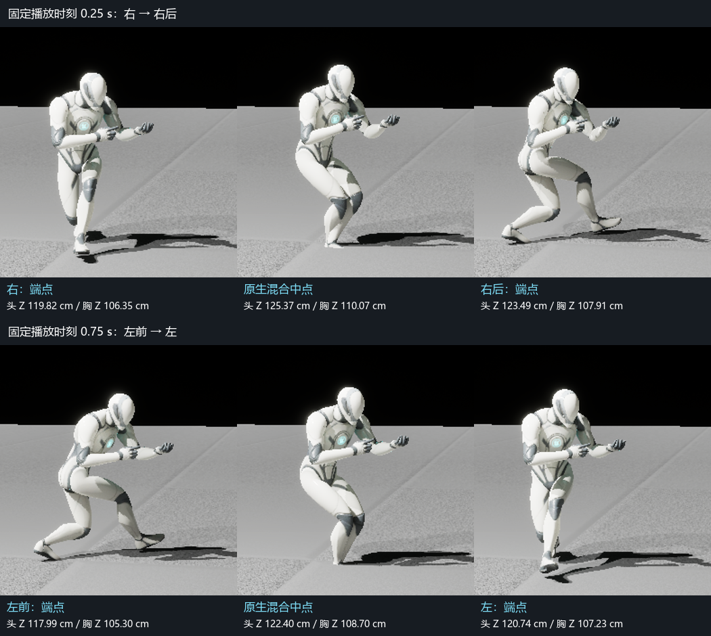

# 已接受八向版本的上半身上移复测

日期：2026-11-21。分支：codex/ue-5.8。
用户已接受当前八向移动表现，本轮只读检查上半身垂直位移，没有否定或改写该验收结论。

## 结论

上半身在部分转向中仍有额外快速上移，不只发生于头骨。
前→后、右→右后、左前→左，以及左右反向较明显。

Actor、网格组件及固定第三人称相机高度没有变化。
上移来自动画骨骼姿态变化，包含 Root 骨轨道、骨盆及胸颈相对姿态的共同贡献。

固定播放时刻的原生对照进一步证明：
即使动作时间不向前推进，仅改变混合方向，也可出现上拱。
部分中间姿态的头胸高度超过两个端点，不能只归因于原始动作高度不同。

本轮没有修复，也没有调整源动作、骨盆、脊柱、步幅、相位或混合参数。

## 当前真实版本

- 地图：/Game/Experiments/Stance_20261022/L_BakedEight_Crouch。
- AnimBP：/Game/Experiments/Stance_20261022/ABP_BakedEight_Crouch。
- BlendSpace：/Game/Experiments/Stance_20261022/BS_BakedEight_Crouch。
- 八段资源引用与前轮相同，所有来源与烘焙序列保持。
- AnimGraph 仍只有 BlendSpace Player、两个方向读取和输出，共四个节点。
- 双轴 SpringDamper 平滑仍为 0.2 秒，DampingRatio=1，MaxSpeed=0。
- 无运行时 OW、分层、AimOffset、IK 或接地补偿。

Audit.json 是本轮重新读取的节点、引脚、样本与实际配置。

## 重新采样范围

直接运行当前 AnimBP，临时保持 Actor 位置不动，仅注入实验 Pawn 的方向输入。
仍由原生播放图推进动画和方向过滤，不改内部权重或播放时间。

- 八个固定方向各采两个完整周期以上，作为正常起伏对照。
- 十六种有向邻接切换，各重复两次并错开开始时刻。
- 前后、左右四种反向切换，各重复四次并错开开始时刻。
- 顺、逆时针连续扫描各一组。

共五十八个用例。
主采 4070 帧，三个出现编辑器帧停顿的用例另行补采。
替换后有效样本 4090 帧，补采没有超过 50 ms 的帧间隔。

错开开始时刻用于覆盖不同播放情况，不代表读取或设置了精确内部 Phase。
本轮没有给正常播放图增加手动 Phase 变量。

Actor Z、网格组件 Z 均保持 0，相机 Z 始终为 135 cm。
头部组件 Z 与直接读取的世界 Z 完全相同。
Pawn 输入与 AnimBP 方向变量最大差为 0。

## 正常起伏对照

八个固定方向的头部完整周期起伏幅度约 2.19～3.69 cm。
固定方向的最大向上速度约 15～30 cm/s，最大单帧上移约 0.50 cm。

这些差异属于原始动作特征，不是统一身体高度的理由。
没有只比较某一个静态高度来判断动画是否合格。

## 转向时的上移

下表头、胸和骨盆的变化均来自同一对相邻帧，间隔约 16.7 ms。

| 转向 | 头部上移 cm | 胸部上移 cm | 骨盆上移 cm |
| --- | ---: | ---: | ---: |
| 前→后 | 2.535 | 1.696 | 1.005 |
| 右→右后 | 1.808 | 1.254 | 0.622 |
| 左前→左 | 1.591 | 1.246 | 0.671 |
| 左→左前 | 1.390 | 1.224 | 0.955 |
| 右→左 | 1.781 | 1.133 | 0.583 |
| 左→右 | 1.085 | 0.832 | 0.550 |

部分短时间累计升幅如下，窗口为对应组中不超过约 100 ms 的最大升幅：

| 转向 | 时间窗口 ms | 头部累计上移 cm |
| --- | ---: | ---: |
| 前→后 | 100.0 | 8.319 |
| 右→右后 | 83.3 | 4.905 |
| 左前→左 | 83.3 | 4.279 |
| 左→左前 | 66.7 | 3.330 |

累计升幅与单帧峰值不一定发生在同一段帧序列中。
这些是本轮有限重复采样的实际结果，不是所有相位下的理论上限。

前→左前的单帧头部向上变化约 0.50 cm，接近正常步态基线。
因此不能把所有方向变化都归为同样严重的问题。

下移也存在，例如后→前代表组的头部单帧下降约 1.87 cm。
当前问题是过渡时快速升降，并非所有转换都会持续向上漂移。

## 最明显一帧的身体链分解

前→后，F_B_repeat2：

- 头部 Z：117.967356 → 120.502851 cm。
- 胸部 spine_05 Z：104.808345 → 106.504704 cm。
- 骨盆 Z：64.390847 → 65.395603 cm。
- 两帧间隔：0.0166666992 秒。

头部 2.535494 cm 的升高可精确分解为：

| 分量 | 对头部垂直变化的贡献 cm |
| --- | ---: |
| Root 骨组件 Z | +1.149349 |
| 骨盆相对 Root 的垂直差 | −0.144593 |
| 胸部相对骨盆的垂直差 | +0.691603 |
| 头部相对胸部的垂直差 | +0.839135 |

因此不是只有骨盆升高。
骨盆以上的胸颈变化又贡献约 1.531 cm。

同一帧左、右肩分别上升约 1.892、1.900 cm。
左、右手分别上升约 2.224、2.909 cm。
上半身整体持姿都受到影响，而不是单个头骨异常。

这里的 Root 是动画骨骼；Actor 世界高度并未改变。
未启用 Root Motion 不等于 Root 骨轨道恒定，二者必须区分。

## 固定播放时刻对照

使用同一个 BS_BakedEight_Crouch 的原生 SingleNode 求值作控制组。
播放速率设为 0，方向过滤仍正常推进，分别固定在 0、0.25、0.5、0.75 秒。
记录的播放位置保持对应时刻，只有浮点精度量级误差。

控制组没有修改资产或普通播放图，用于隔离方向混合与步态时间推进。

代表结果：

- 前→后，固定 0.25 秒：头部仍从约 118.03 cm 升至峰值 124.35 cm。
- 右→右后，固定 0.25 秒：右为 119.82 cm，右后为 123.49 cm。
- 上述右→右后过滤过程中，头部峰值约 125.52 cm，高于两个端点约 2.03 cm。
- 左→左前，固定 0.75 秒：目标头部更低，但中间仍先升高约 1.78 cm，再下落。

这证明当前混合存在中间姿态上拱，不能用正常抬腿或完整周期起伏解释。
也不能仅靠把来源骨盆高度统一来推导修复方案。

## 固定时刻画面复核

上排固定 0.25 秒：右、右／右后中点、右后。
下排固定 0.75 秒：左前、左前／左中点、左。

三列分别是原生 BlendSpace 的端点和固定中间输入，不是人工摆姿态。
每排使用同一播放位置、同一相机、同一裁剪范围，没有按头或脚重新对齐。

实际静态中点数据：

| 固定时刻及方向 | 较高端点的头 Z cm | 中点头 Z cm | 中点超出 cm |
| --- | ---: | ---: | ---: |
| 0.25 秒，右／右后 | 123.492 | 125.365 | 1.873 |
| 0.75 秒，左前／左 | 120.735 | 122.403 | 1.668 |

中点和过滤过程峰值不完全相同，因此不把这两组数值混为同一帧。
主结论来自正常运行采样；画面用于复核固定时刻的上拱形态。

曾尝试逐帧停播取图，但该次未能验证动画实际推进，相关图和数据已拒收。
拒收材料只留在本轮 Saved 目录，不作为本报告证据。
最终采用的是上述可重复的原生固定时刻端点／中点对照。

## 根因判断与边界

已证实：

1. 来源方向的完整身体姿态存在差异，转向时上半身也随全身混合变化。
2. 当前原生 BlendSpace 的部分中间姿态比两端更直、更高。
3. 原始身体差异、全身姿态组合及快速过渡共同产生额外上移。
4. 本次固定第三人称采样中，相机与 Actor 位移不是上移来源。
5. 当前图没有运行时 OW，不能把本次问题继续归因于运行中的 OW 节点。

尚未实施或证实：

- 没有选择新的混合方式或修复策略。
- 没有宣称某一原始来源动作错误，或需要统一身体高度与前倾。
- 没有定位到引擎 Bug。
- 没有将此结果直接推广为正式持枪或第一人称 Gameplay 验收结论。

## 保护、交还与证据

前后 SHA-256 检查覆盖 2394 个既存文件。
动画、BlendSpace、AnimBP、地图、Skeleton、代码、配置与历史报告均保持。
允许变化仅为当前实验索引和唯一工作区进度文档，无文件丢失。

已恢复干净可见的 L_BakedEight_Crouch PIE。
原始输入与播放状态已恢复，WASD 全部释放，Actor 在原点，Pawn Tick 启用。
帧率、后台节流、抗锯齿与运动模糊均恢复原值，无脏资产或地图。

证据包括：

- Audit.json：本轮实际配置与图。
- DynamicFrames.json.gz、RetryFrames.json.gz：正常播放与补采。
- FinalCaseMetrics.json、Summary.json：补采替换后的统计和同帧分解。
- FixedPhase.json.gz、FixedPhaseAnalysis.json：十六组固定时刻控制实验。
- Visual.json、VisualShots/、UpperBody_Comparison.png：原生端点与中点画面。
- Handoff.json、Protection.json：恢复状态与保护检查。
- Scripts/：只读采样及分析脚本。

本轮检查结束，没有自动修复。
