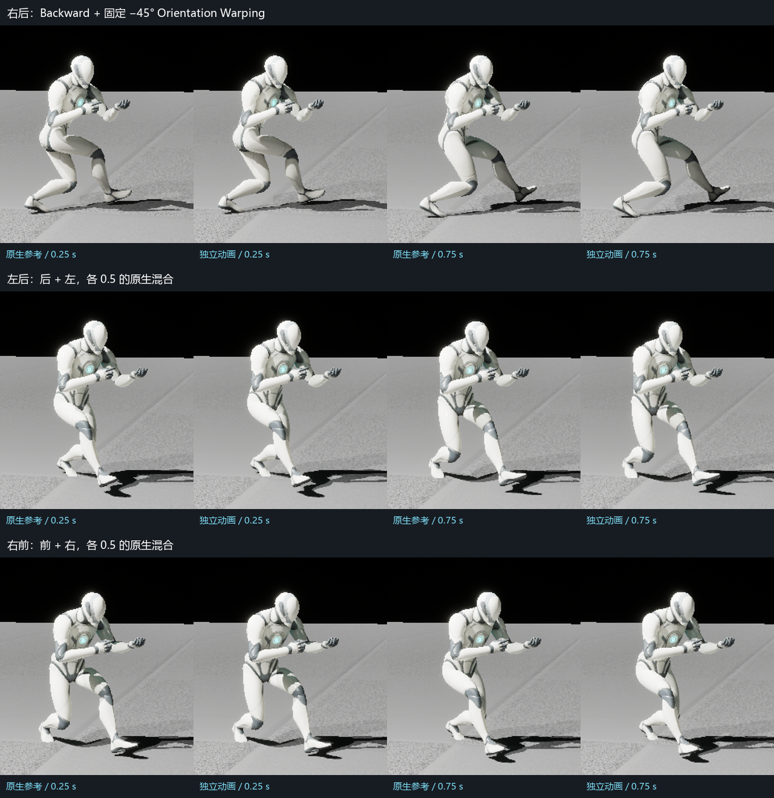

# 右后、左后与右前三段独立动画烘焙

日期：2026-11-21。工程：ShootGame_UE58。分支：codex/ue-5.8。
本轮只制作和验证三段动画，没有接入新的八向 BlendSpace 或替换地图运行图。

## 新序列及真实来源

三段均位于 /Game/Experiments/Stance_20261022 根目录。

| 方向 | 新序列 | 来源 |
| --- | --- | --- |
| 右后 | AS_OWBaked_BackRight | Backward＋原生固定 −45° OW |
| 左后 | AS_BlendBaked_BackLeft | Back＋Left，各 0.5 |
| 右前 | AS_BlendBaked_ForwardRight | Forward＋Right，各 0.5 |

来源全部是当前四段 AS_RootLockSource 动画，没有引用旧斜向或镜像序列。
上一段已认可的 AS_OWBaked_FrontLeft 未修改。

三段均绑定现有 SK_FourDirection，使用 SKM_Manny_Simple 网格验证。
时长均为一秒，原始数据模型为 60 Hz、61 组关键帧、89 条骨骼轨道。
沿用项目默认平台 30 Hz 压缩；编辑器显示的 31 个压缩采样点与原始数据模型不同。
Enable Root Motion=false，Force Root Lock=false。

## 准确的原生求值图

右后：

```text
SampleTime → Sequence Evaluator (AS_RootLockSource_Back)
 → Local To Component
 → Orientation Warping (Manual，固定 −45°)
 → Component To Local
 → Output Pose
```

参数沿用上一段左前已验收方案：
Z 轴、ComponentTransform、Alpha=1、DistributedBoneOrientationAlpha=1。
spine_01 至 spine_05 各分配 0.2，RotationInterpSpeed=0，MaxCorrectionDegrees=65。
IK 脚骨引用保持原配置，没有新增 Leg IK 或接地处理。

右后目标方位是 135°，相对后退基准 180° 的修正为 −45°。
不是镜像左后，也不是将四路 Warping 的混合结果录下来。

左后与右前：

```text
Forward / Right → BlendSpace Evaluator
SampleTime → NormalizedTime
BlendSpace Evaluator (BS_Bake_CardinalSource)
 → Output Pose
```

该图没有 Orientation Warping、分层、AimOffset 或 IK。

原四向 BlendSpace 在前次资源清理中已删除。
本轮新增 BS_Bake_CardinalSource，仅用于恢复原生混合求值：

- 横轴 Forward，纵轴 Right，范围均为 −1～1。
- 前 (1,0)、后 (−1,0)、左 (0,−1)、右 (0,1)。
- 仅引用当前四段原始序列，无中心 Idle 或斜向动画。
- 左后输入 (−0.5,−0.5)，右前输入 (0.5,0.5)。
- 各来源播放速率为 1，共同周期一秒，无相位偏移。
- 保留 0.2 秒轴过滤，先固定方向充分稳定后再逐时刻取样。
- 采用原生三角化与默认局部旋转混合，没有自定义骨骼混合算法。

新增三个辅助资产：

- BS_Bake_CardinalSource。
- ABP_Bake_CardinalBlend。
- ABP_OWBake_BackRight。

完整节点、连线、样本与参数见 Graphs.json、Handoff.json。
辅助资产没有接入 Pawn 初始化或当前地图。

## 原混合表现的回归

先新采集原生参考，再与保留的历史验收采样逐骨比较。
历史 NativeBlendPoses.json 只用作回归依据，没有当作生成输入。

当前四段原资源保持原样，同相位对照结果如下：

| 原生混合方向 | 61 个时刻、89 骨的最大位置差 cm |
| --- | ---: |
| 左后 | 0.000024105 |
| 右前 | 0.000025117 |

因此本轮恢复的是原先认可的普通混合结果，
没有用当前四路 OW 输出替代左后或右前。

历史采样保存在 SourceAssets/BlendMirrorEight_20261117/NativeBlendPoses.json。
本轮未运行该目录的旧制作、镜像或导入脚本。

## 烘焙方式与数据有效性

对三段原生图分别采集 0～1 秒、1/120 秒间隔的 121 个姿态。
每个时间点均等待真实 AnimGraph 求值。
保留其中每隔一个点的姿态，写入 60 Hz 原始轨道；其余点用于独立验证帧间插值。

将组件变换通过 UE 原生 MakeRelativeTransform 转为父骨局部变换，
经 AnimationDataController 写入平移、旋转与缩放。
没有重新解算步态、归一身体姿势、改变支撑相位或焊接循环首尾。
没有把 Actor 世界位移、相机或网格安装旋转录入 Root。

初次创建辅助 BlendSpace 时，直接写样本尚未生成有效运行时三角化。
原生回归比对识别出参考姿势，该批数据已拒收，没有用于动画制作。
随后通过原生 BlendSpace 编辑器构造时的 ResampleData 完成三角化并重采。
生成脚本在写入前强制检查左后、右前回归误差，避免将无效输出烘焙为动画。

拒收数据仅保留在本轮 Saved 目录，文件名明确带 Rejected。
本报告 NativeSamples.json.gz 是重采后通过回归检查的有效数据。

## 烘焙保真验证

全部三段均逐骨检查 61 个关键时刻和 60 个半帧时刻。
下表为真实压缩求值结果，旋转差使用归一化四元数计算。

| 方向 | 最大位置差 cm | 最大旋转差 ° |
| --- | ---: | ---: |
| 右后 | 0.005911 | 0.062838 |
| 左后 | 0.009893 | 0.037005 |
| 右前 | 0.022188 | 0.066414 |

原始轨道关键时刻最大位置误差均小于 0.00014 cm。
原始轨道半帧最大位置误差分别约为 0.01231、0.00735、0.01075 cm。
没有为追求更小数字而修改源动作或项目压缩设置。

详见 Verification.json。
这些指标证明烘焙保真，不代表新序列的视觉自然度已通过人工验收。

## 独立播放与循环

三段分别以 AnimSingleNodeInstance 实际循环播放，没有运行时 OW 或混合图。

| 方向 | 采样帧数 | 实际时长 s | 循环回绕次数 |
| --- | ---: | ---: | ---: |
| 右后 | 182 | 3.197 | 3 |
| 左后 | 187 | 3.195 | 3 |
| 右前 | 192 | 3.198 | 3 |

实际组件与相同播放时间的压缩资产求值，最大位置误差均小于 0.000191 cm。
角色 Actor 世界 Z 始终为 0，没有整体抬高。

抽查 root、pelvis、head、foot、ball 的首尾：
最大首尾位置差分别约为右后 0.01276、左后 0.00656、右前 0.01997 cm。
没有主动改写首尾或消除原始动作起伏。
完整首尾参考与独立序列对照见 PlaybackAnalysis.json。

## 画面证据



每行同一方向，每两列分别是同一相位的原生参考和独立序列。
采集 0.25 秒、0.75 秒两组代表相位。
所有截图明确指定同一个 PIE 窗口，相机均为 (155,620,135)。
使用固定裁剪，没有按头部、脚部或身体重新对齐。

对应实际组件最大位置差约为右后 0.00230、左后 0.00427、右前 0.00733 cm。
原生参考使用辅助图；独立序列画面使用 SingleNode 播放。

三段画面未观察到相对来源新增的明显姿态变化。
保留来源的身体前倾、骨盆变化、双脚运动和原有接地表现。
本轮没有新增鞋面蒙皮接地分析，也没有修复原有穿地或脚滑。

## 交还与边界

三个新序列已在可见动画编辑器中打开，当前选中 AS_OWBaked_BackRight。
可通过编辑器标签切换右前、左后、右后进行人工验收。
独立序列播放不依赖烘焙辅助图。

尚未实施：

- 将四条斜向接入新的八向 BlendSpace。
- 方向切换或相邻方向插值修复。
- 下蹲 Idle、上身重构、WeaponAction、正式 Gameplay 或网络接入。

已有左前加上本轮三段，使四条斜向独立资源齐备。
这不等于新的八向系统已通过验收，也不证明之前的转向升降问题已经解决。

## 保护与文件清单

新增六项 .uasset：三段序列、两个辅助 AnimBP、一个辅助 BlendSpace。
全部仍在 Stance_20261022 根目录。

既存 2304 个文件的 SHA-256 保护检查，允许变化仅为当前实验索引与工作区进度文档。
原四段动画、已认可左前、Skeleton、生产资源、原地图、代码、配置与历史报告均保持。
无文件丢失，详见 Protection.json。

本轮没有修改 C++、编译、刷新 VS 工程、新建分支、暂存或提交。
所有新增资产已保存，无脏内容包或地图。
临时帧率、后台节流、抗锯齿和运动模糊已恢复。

证据包括：

- Audit.json、Graphs.json、Bake.json、Handoff.json：来源、实际设置与保存状态。
- SourceRegression.json：左后、右前对原验收混合的回归。
- NativeSamples.json.gz：三段原生完整周期和半帧参考。
- Verification.json：原始／压缩轨道保真。
- Loops.json.gz、PlaybackAnalysis.json：真实独立循环与接缝。
- WindowShots.json、WindowShots/：同相机原生截图与骨骼。
- Comparison.png、Comparison_*.png、AssetEditor.png：可视化与可见验收入口。
- Scripts/：本轮烘焙、原生求值与检查脚本。

本轮停止在三段烘焙完成，等待用户人工验收。
