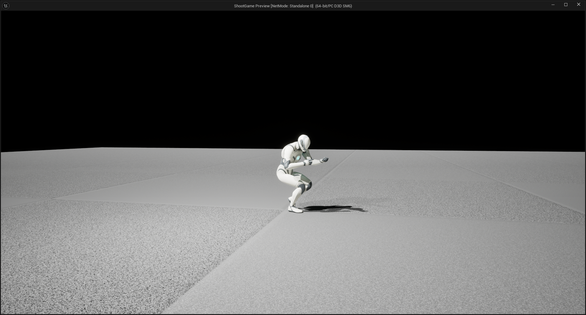

# 下蹲移动最终环境整理与资源清理

日期：2026-11-22。工程为 ShootGame_UE58，分支为 codex/ue-5.8。
承接用户对 0.3 秒版本的最终验收，本轮只整理环境、删除多余资产。

## 最终环境

实验目录由 35 项减至 14 项，全部保留在原目录：

/Game/Experiments/Stance_20261022

唯一地图入口为 L_Smoothing03_Crouch，使用 BP_Smoothing03GameMode。
运行类为 ABP_Smoothing03_Crouch_C，原生 BS_Smoothing03_Crouch 直接输出姿态。
Forward／Right 两轴 Smoothing Time=0.3 秒，没有增加实时 OW、IK 或接地补偿。
WASD 和组合键控制实际移动，V 沿用现有第三人称观察视角。
不改变正式项目地图、GameMode 或生产 Gameplay 设置。

保留清单：

| 类型 | 资产 |
| --- | --- |
| 地图 | L_Smoothing03_Crouch |
| GameMode | BP_Smoothing03GameMode |
| 预览场景蓝图 | BP_BakedEightPreview |
| AnimBP | ABP_Smoothing03_Crouch |
| BlendSpace | BS_Smoothing03_Crouch |
| Skeleton | SK_FourDirection |
| 前 | AS_RootLockSource_Forward |
| 右前 | AS_BlendBaked_ForwardRight |
| 右 | AS_RootLockSource_Right |
| 右后 | AS_BackRight_TorsoReference |
| 后 | AS_Back_TorsoReference |
| 左后 | AS_BackLeft_TorsoReference |
| 左 | AS_RootLockSource_Left |
| 左前 | AS_OWBaked_FrontLeft |

## 删除范围与依赖依据

从最终地图递归追踪硬引用、软引用、搜索及管理引用，得到上述 14 项。
其余 21 项的引用者均位于同批删除集合，未发现保留资产或目录外引用。
逐项路径、类型和原引用关系保留于 Audit.json。

删除包括：

- 6 项旧 AnimBP：实时 OW、旧八向、0.2 秒对照和三个烘焙辅助图。
- 3 项未使用序列：原后退、原烘焙右后和原烘焙左后。
- 3 项旧 BlendSpace。
- 4 项旧 GameMode，以及 1 项旧 OW 预览蓝图。
- 4 张旧地图：实时 OW、旧八向、后退对照、0.2 秒对照。

未按名称猜测删除范围，未删除原始 FBX、SourceAssets 或历史验证材料。
删除前对 21 项制作并校验备份，位置记录在 Backup.json。
备份位于 Saved，不作为 Content 内的实验资产保留。
所有资产均通过 EditorAssetLibrary.delete_loaded_assets 原生批量删除。
没有文件系统直接删除、移动或替换 uasset，也没有使用重定向器绕过依赖。
本轮没有资产迁移；复查无重定向器，无需执行迁移修复。

## 启动默认路径同步

实验 GameMode 的 C++ 默认路径此前仍为 ABP_OWLocalMovement。
最终地图虽已覆盖为正确类，删除旧图后该原生默认值将成为失效路径。
仅将 ShooterStancePreview.cpp 中的此路径替换为 ABP_Smoothing03_Crouch_C。
未改变来源选择、骨骼处理、输入、移动或动画执行逻辑。
正常关闭编辑器后编译，并重新启动最终地图。

## 验证结果

- 项目 Editor 编译通过，使用 UsePrecompiled、NoEngineChanges。
- 冷启动后原生 GameMode 默认值与最终蓝图值均指向正确 AnimClass。
- AnimGraph 节点、八个样本及平滑参数读回与清理前完全一致。
- 14 项保留资产的文件哈希均保持，包含全部最终动画与 Skeleton。
- 全项目 504 项资产引用复查：无指向已删资源的引用。
- 保留资产无缺失 Game 依赖、无重定向器、无未保存内容或地图。
- 真实窗口定向键盘回归采集 596 帧，覆盖八方向及每次松键停止。
- 八向实际速度均为 150 cm/s，松键速度为 0，Actor Z 保持 0。
- 全程仅使用最终 AnimClass，输入与图变量一致，采样骨骼数值有限。
- 已恢复干净可见 PIE；全部方向键释放，FPS 与后台节流配置恢复。
- Source include 检查及 git diff --check 通过。

首次重启后的控制台未能聚焦，经窗口读取确认后选择主窗口再执行。
一次只读校验因精确比较 0.3 的浮点表示而中止，尚未启动 PIE。
已改用精度容差；该次空采样未作为通过证据，随后完整重跑通过。
构建含现有 API 弃用及 include 顺序提醒，没有在本轮扩展处理。

## 验收边界与历史材料

本轮验证资源清理后的保真、启动和可操作性，不重新宣称动画自然度通过。
既有上拱、脚部下沉、方向响应延迟沿用最终版本的已接受限制。
未接入持枪系统、第一人称、GAS、网络或正式角色。
原 0.2 秒与旧 OW 地图资产已删除，历史报告中的入口只代表当时状态。
历史报告、最终验收原文和原始证据均保留；以本记录说明最新环境。
不创建新分支，不提交或改写 Git 历史。

## 证据

- Audit.json、DeleteResult.json、ReferencesAfter.json：清理集合与引用结果。
- SemanticComparison.json：图、样本和参数保持检查。
- KeyboardSummary.json、KeyboardFrames.json.gz：八向输入与实际移动。
- Handoff.json：最终地图、AnimClass、输入与保存状态。
- Protection.json：逐文件保护检查。
- SamplingScripts.zip：审计与回归采样脚本。
