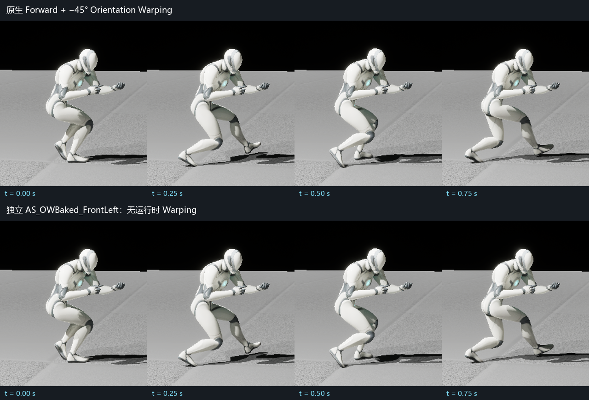

# 单段左前 Orientation Warping 离线烘焙验证

日期：2026-11-21。工程：ShootGame_UE58，原分支 codex/ue-5.8。
本轮只烘焙左前，不修改原动画，不接入 BlendSpace，不处理其他方向。

## 交付

新增两项，均位于现有实验根目录：

- /Game/Experiments/Stance_20261022/AS_OWBaked_FrontLeft
- /Game/Experiments/Stance_20261022/ABP_OWBake_FrontLeft

第一项是独立 Animation Sequence，播放时不需要 Orientation Warping。
第二项仅用于烘焙与复查，没有接入当前地图或 Pawn 的启动流程。

输入仍是当前原始 AS_RootLockSource_Forward。
Skeleton 仍为当前 SK_FourDirection，网格为 SKM_Manny_Simple。
原始 FBX、四段来源、Skeleton、当前运行 AnimBP 与地图均保持原样。

## 单路求值与烘焙

准确图拓扑：

```text
SampleTime
    ↓ ExplicitTime
Sequence Evaluator (AS_RootLockSource_Forward)
 → Local To Component
 → Orientation Warping (Manual，固定 −45°)
 → Component To Local
 → Output Pose
```

没有四路来源选择、Layered Blend Per Bone、AimOffset、WeaponAction 或新 IK。
SampleTime 是唯一新增变量，由离线采样脚本赋值；图不自行计算方向或相位。

OW 参数从当前已验收配置读取：

- Manual，RotationAxis=Z，WarpingSpace=ComponentTransform。
- OrientationAngle=−45°，Alpha=1，DistributedBoneOrientationAlpha=1。
- Spine 为 spine_01 至 spine_05，原生分配各 0.2。
- RotationInterpSpeed=0，MaxCorrectionDegrees=65。
- ik_foot_root、ik_foot_l、ik_foot_r 保持原配置。

完整参数、节点与连接见 Graph.json。

按固定 1/60 秒的时间网格采集 0～1 秒，共 61 个采样点、89 根骨骼。
每个时间点等待原生 AnimGraph 完成求值，不使用墙钟抖动作为动画时间。

由 UE 原生 MakeRelativeTransform 转回父骨局部空间，
再经 AnimationDataController 写入平移、四元数与缩放关键帧。
这里只做求值结果的坐标转换与存储，没有自行实现 FK、IK 或重新生成运动轨迹。

没有移除 Root 骨变换，也没有把角色世界位置或网格 Yaw=−90° 的安装变换录入序列。
没有统一骨盆高度、前倾、步幅、支撑比例、重心或脚部轨迹。

本轮没有使用实时录制器直接录墙钟时间。
前期核对的原生 Recorder 证明可记录最终网格姿态；
实际采用固定 SampleTime 加原生数据控制器写轨道，以便准确比较同一相位。

本地核对实现：

- Runtime/Engine/Classes/Animation/AnimData/IAnimationDataController.h。
- Editor/SequenceRecorder/Private/AnimationRecorder.cpp。
- AnimationWarping 插件 Runtime 模块的 AnimNode_OrientationWarping.cpp。

官方参考：
[原生姿态录制器](https://dev.epicgames.com/documentation/en-us/unreal-engine/API/Editor/SequenceRecorder/FAnimationRecorder)。

## 资产实际设置

- 时长 1 秒，RateScale=1。
- 原始数据模型为 60 Hz、60 个时间间隔、61 组关键帧。
- 89 条骨骼轨道，绑定现有实验 Skeleton。
- EnableRootMotion=false，ForceRootLock=false。
- 保留项目默认的平台目标 30 Hz 与 Allow Frame Stripping。
- 因此当前编辑器压缩播放显示 30 Hz、31 个采样关键帧，不应与原始数据模型混淆。

未为本段动画添加新的压缩规则。
下述误差已针对真实压缩结果重新测量，不仅检查原始写入数据。

## 数值验证

以单路原生 Warping 为参考，比较全部 89 骨：

| 对照 | 最大位置误差 cm | 最大旋转误差 ° |
| --- | ---: | ---: |
| 61 个关键时刻，原始数据求值 | 0.0001384 | 0.0001523 |
| 61 个关键时刻，压缩数据求值 | 0.0036356 | 0.0636104 |
| 121 个时刻含半帧，原始数据求值 | 0.0154397 | 0.0545104 |
| 121 个时刻含半帧，压缩数据求值 | 0.0036356 | 0.0636104 |

四元数角度比较先归一化，避免把浮点单位长度误差当作实际旋转误差。
所有时间点均重新运行原生求值，不以离线插值结果代替参考。

另在同一实际网格组件上逐一切换原生 Warping 与独立 SingleNode 动画，
对比八个代表相位，最大组件位置误差 0.003309 cm，最大旋转误差 0.04538°。

数值支持本段烘焙的姿态保真，不代表接地或视觉自然度已经通过人工验收。

## 独立播放及接缝

脱离测试 AnimBP，以 AnimSingleNodeInstance 实际循环播放：

- 共 191 帧，约 3.197 秒，观察到三次循环回绕。
- 运行时类始终为 /Script/Engine.AnimSingleNodeInstance，没有 Warping 节点。
- 与同一序列在实际播放位置的原生压缩求值比较，最大位置误差约 0.000194 cm。
- 角色世界 Z 保持 0，没有通过移动 Actor 掩盖动画位移。

首尾对照：

| 骨骼 | 原生参考首尾位移 cm | 烘焙首尾位移 cm |
| --- | ---: | ---: |
| root | 0 | 0 |
| pelvis | 0 | 0 |
| head | 0.004719 | 0.005085 |
| foot_l | 0.002041 | 0.004120 |
| foot_r | 0.000202 | 0.000201 |
| ball_l | 0.002802 | 0.005660 |
| ball_r | 0.000247 | 0.000246 |

没有主动焊接、修正或重建首尾关键帧。
上述差异来自原有首尾差异及序列压缩，未发现新增的明显循环接缝跳变。

## 视觉对照



上排是原生固定 −45° Warping，下排是独立序列。
全部画面指定同一个 PIE 窗口采集，使用相同相机与固定裁剪。
相机位置为 (155,620,135)，角色和网格世界变换保持一致。
没有按头、脚或身体重新对齐画面。

另保留 AssetEditor.png，展示独立序列在可见动画编辑器中打开的状态。

原生 Shot 命令最初捕获到另一个动画编辑器视口，已识别为无效证据。
这些画面仅隔离保存在本轮 Saved/下的 ShotsWrongViewport，不用于本报告。
本报告图片来自明确指定窗口的官方 Slate Screenshot。

与 B 方案相比，四个代表相位未观察到新增的明显姿态差异。
原有步态、身体前倾及腰背扭转继续保留。
原有接地不足没有修复；本轮未新增鞋面蒙皮重建或接地补偿。

## 当前边界与人工验收

本轮完成的是单段烘焙保真与独立播放验证，视觉质量等待用户验收。

没有验证或替换以下内容：

- 左前与前、左的 BlendSpace 插值。
- 快速转向时的上半身升降。
- 其他三个斜向。
- 下蹲 Idle、正式持枪、WeaponAction、Gameplay 或网络。

独立动画并不会自动修复相邻来源混合的问题。
原地图仍使用原有 ABP_OWLocalMovement，未将本段偷偷接入。

当前可见编辑器已打开 AS_OWBaked_FrontLeft。
可直接在动画编辑器中循环播放验收；不需要启动原四路 Warping 系统。
烘焙辅助 AnimBP 为固定采样图，其 SampleTime 可用于复查，不是新的运行时架构。

## 修改范围与保护

原有 2269 个文件的 SHA-256 保护检查未发现资产、来源或代码变化。
允许更新的文件仅为当前实验索引与唯一工作区进度文档，详见 Protection.json。

本轮未编译 C++、未新增分支、未暂存或提交。
当前 .uasset 新增仅前述两项，所有资产均已保存，无脏地图或内容包。

证据：

- Bake.json、Graph.json、Handoff.json：资产设置、实际拓扑、编辑器状态。
- NativeSamples.json.gz、NativeSamplesDense.json.gz：原生 60/120 Hz 参考。
- KeyVerification.json、DenseVerification.json：原始／压缩序列对照。
- Playback.json.gz、PlaybackAnalysis.json：实际组件与循环播放。
- WindowShots.json、WindowShots/、Comparison.png：指定 PIE 窗口的视觉证据。
- Protection.json：既存文件保护与新增资产清单。
- Scripts/：本轮创建、采样、写入和验证脚本，不自动接入当前地图。

烘焙完成后到此停止，等待人工验收。
