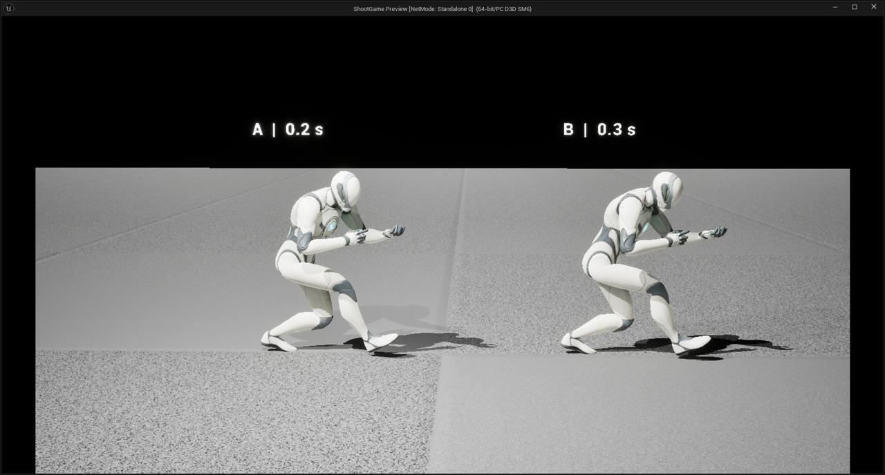

# 八向下蹲 Smoothing Time 0.2／0.3 秒对照

日期：2026-11-22。工程为 UE58 工作树，分支为 codex/ue-5.8。
本轮只改变独立副本的两个方向轴平滑时间，未修改动画。

## 结论

0.3 秒可以减缓关键转换中的快速上移，但没有消除中间姿态的上拱。
固定相位对照的最高头部位置基本不变，说明同类混合姿态仍被经过。
正常播放中，最高点随混合经过时的步态相位变化；不能保证全方向降低高度。
姿态接近目标的时间增加约 67～167 ms，中位数约 100 ms。
八个稳定方向输出保持一致，转向脚部下沉仍存在，不能宣布视觉验收通过。

## 资产与准确拓扑

资产均在以下根目录：

/Game/Experiments/Stance_20261022

- A 保留 BS_TorsoReferenceEight_Crouch、ABP_TorsoReferenceEight_Crouch。
- B 新增 BS_Smoothing03_Crouch、ABP_Smoothing03_Crouch。
- B 新增 BP_Smoothing03GameMode、L_Smoothing03_Crouch。
- 两张地图复用已有预览 Pawn；B 的 GameMode 从启动时直接指定新 AnimClass。

AnimGraph 均为 Forward、Right 变量 → 原生 BlendSpace Player → Output。
事件图从预览 Pawn 读取 PreviewForward、PreviewRight，不增加骨骼修正。
Player 为循环、PlayRate=1、StartPosition=0，无同步组，Method=DoNotSync。
没有实时 OW、Layered Blend Per Bone、AimOffset 或 IK。

Forward／Right 两轴为 SpringDamper，A 为 0.2 秒，B 为 0.3 秒。
DampingRatio=1、MaxSpeed=0、WeightSpeed=0，其余设置保持。
使用原有三角插值，无逐骨权重配置，无播放速度缩放。
18 项相关设置读回仅 InterpolationParam 不同；见 Create.json。
图的必要资源引用相应指向各自 BlendSpace，拓扑保持不变。

八个样本及坐标保持不变，以下名称均相对于上述根目录：

| 方向 | Forward | Right | 动画 |
| --- | ---: | ---: | --- |
| 前 | 1 | 0 | AS_RootLockSource_Forward |
| 右前 | 0.5 | 0.5 | AS_BlendBaked_ForwardRight |
| 右 | 0 | 1 | AS_RootLockSource_Right |
| 右后 | −0.5 | 0.5 | AS_BackRight_TorsoReference |
| 后 | −1 | 0 | AS_Back_TorsoReference |
| 左后 | −0.5 | −0.5 | AS_BackLeft_TorsoReference |
| 左 | 0 | −1 | AS_RootLockSource_Left |
| 左前 | 0.5 | −0.5 | AS_OWBaked_FrontLeft |

Skeleton 为 SK_FourDirection；网格沿用原预览 Manny。
八段均为 1 秒，序列与样本 RateScale=1，RootMotion 和 ForceRootLock 均关闭。
没有 SyncMarker；共同归一化时间不等于左右支撑相位已对齐。
现有三个 TorsoReference 序列包含此前离线脊柱／颈部旋转，本轮没有调整。

## 采集方法

主采集使用同一 PIE 世界中的两份真实 AnimBP，输入、初始相位及世界时间相同。
8 个稳定方向及 8 类转换按四种起始等待时间测试，共 40 组、2966 帧。
DynamicPair 案例名中的 phase0.25 等表示等待时间，并非准确的输入起始相位。
每帧另读原生 GetInstanceAssetPlayerTime，A/B 最大相位差为 0.000000179 秒。
同案例内无超过 50 ms 的采样间隔。

另对右→右后、前→后、后→前进行实际相位触发采集。
等待相位经过 0、0.25、0.5、0.75 后触发，共 12 组、732 帧。
相位触发误差容许 0.018 秒，原始实际值留在 FocusPair 数据中。
A/B 最大相位差为 0.000000120 秒，无超过 50 ms 的采样间隔。

固定相位控制使用原生 SingleNode BlendSpace，不是完整 AnimBP。
播放时间冻结，世界时间继续推进以运行原生输入平滑。
上述三种转换各测试四个固定相位，共 12 组、660 帧，实际相位误差为零。
所有数值证据来自骨骼采样，不从录屏估计。

## 固定相位结果：速度降低，高度保留

以下为 Phase=0.25；Z 是头骨组件空间位置，单位 cm。
“峰速”指相邻采样的最大向上速度，单位 cm/s。

| 转换 | A 最高 Z | B 最高 Z | A 峰速 | B 峰速 |
| --- | ---: | ---: | ---: | ---: |
| 右→右后 | 123.8821 | 123.8821 | 98.47 | 65.88 |
| 前→后 | 121.9502 | 121.9498 | 83.20 | 64.96 |
| 后→前 | 121.8074 | 121.8077 | 89.20 | 60.58 |

12 组固定相位测试中，最高 Z 的最大 A/B 差异仅 0.00513 cm。
因此不是上拱消失，而是通过同类混合姿态的时间变长。

## 正常播放结果

以下取每类转换四个实际起始相位中的最大值。
最高 Z 与最大速度可能出现在不同案例，不应配对解读。

| 转换 | A 向上峰速 | B 向上峰速 | A 最高 Z | B 最高 Z |
| --- | ---: | ---: | ---: | ---: |
| 右→右后 | 97.67 | 61.86 | 123.8184 | 123.5451 |
| 前→后 | 97.91 | 72.15 | 123.2232 | 123.0524 |
| 后→前 | 96.94 | 67.53 | 122.5253 | 122.7655 |

对应向上峰速下降约 37%、26%、30%。
但后→前的最高点反而增加约 0.24 cm，不能说整体位移幅度已降低。

用原生目标序列在同一实际相位的姿态作为参考，测量姿态接近目标的时间。
指标为 root、pelvis、spine_05、head、foot_l、foot_r 的最大位置误差。
首次全部小于等于 1 cm，且余下记录窗口不再超标，视为接近目标。
这不是硬件输入延迟、Actor 移动延迟，也不是对样本权重的直接测量。

12 组实际相位触发测试中，B 比 A 多花 66.7～166.7 ms，中位数 100.0 ms。
固定 Phase=0.25 的右→右后，A 为 0.267 秒，B 为 0.400 秒。
固定方向参考求值误差小于 0.000097 cm，支持相位与参考匹配可靠。

## 原有表现与脚部风险

八个稳定方向的 A/B 关键骨位置最大差异约 3.6×10^-14 cm。
转向期间因权重推进速度不同，下肢中间姿态当然不同，不能称为全程相同。
主采集中 Preview 输入与图变量一致，Actor Z 和网格相对 Z 均为 0。
没有抬高 Root、角色或相机作为补偿。

主采集中最低 ball 骨组件 Z：A 为 −14.41 cm，B 为 −16.09 cm。
A 出现在左前→左，B 出现在后→前，属于有限相位覆盖的最低观测值。
这些是骨骼位置代理，不能当作鞋面实际穿地深度或全相位最坏界限。
结果只说明 0.3 秒没有解决转向的脚部下沉，部分采样更深。
没有新增接地算法，也未以接地数值统一原动画。

## 可视化与手动验收

[A/B 原生窗口动图](Smoothing_AB.gif)中左侧 A 为 0.2 秒，右侧 B 为 0.3 秒。
角色网格、Skeleton、地面及相机相同，两个角色仅横向分开放置。
观察右→右后、前后切换时仍有身体升降，尚不能作出自然度通过结论。
动图由原生 Slate 截图生成，截取调用会扰动帧时，不能用于速度定量。
外部桌面录制未通过画面核验，已丢弃，未作为证据保存。

手动入口：

/Game/Experiments/Stance_20261022/L_Smoothing03_Crouch

保留可见 PIE，WASD 实际移动、组合键斜向移动，沿用原预览的 V 视角切换。
0.2 秒对照仍可打开 L_TorsoReferenceEight_Crouch，不新增运行时切换功能。
第一人称、持枪系统、生产 Gameplay 与网络不在本轮验收范围。

## 文件与保护

新增 Content 仅上述四项，不覆盖原地图、BlendSpace 或 AnimBP。
新增本报告目录及原始数据、分析、截图、动图、只读采样脚本。
仅在当前实验索引前追加入口；历史报告保留原文。
本轮唯一工作区进度文档更新为等待人工验收。
完整保护核对见 Protection.json，交接状态见 Handoff.json。

创建时曾因固定数组结构体副本未回写，首次设置读回没有变化。
在创建其余资源前已发现，改用完整数组赋值并验证最终两轴均为 0.3 秒。
该失败记录没有作为测试结果；未修改或保存基线资源。

停止于本次参数对照，不进一步调整 Weight Speed、动作相位或任何动画轨道。
是否保留 0.3 秒取决于人工对升降感与方向响应的取舍。
