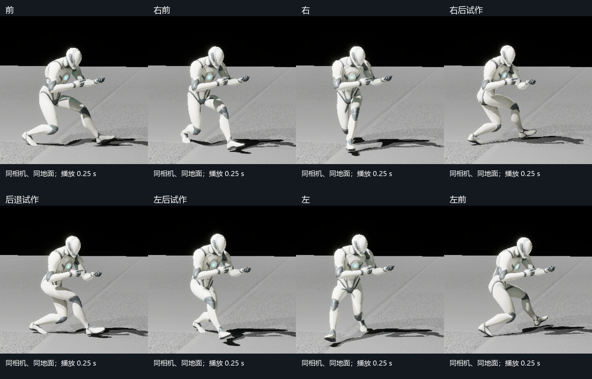
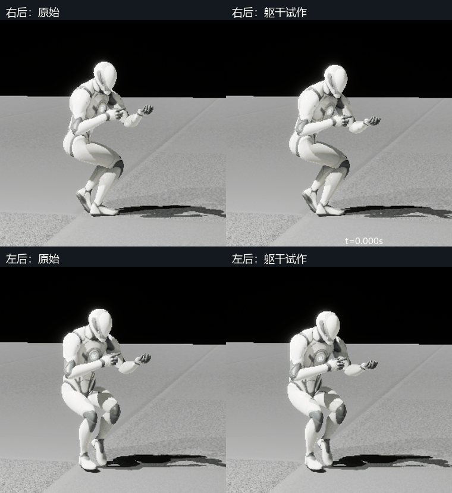

# 其余方向躯干试作与独立八向预览

日期：2026-11-22。UE 5.8.4。工程：ShootGame_UE58。分支：codex/ue-5.8。
本轮延续单段后退试作，不作为正式动画方案验收。

## 可操作入口

地图：/Game/Experiments/Stance_20261022/L_TorsoReferenceEight_Crouch。

- WASD 与组合键：八向实际移动，速度 150 cm/s。
- 松键：停止并停在最后姿态；没有新增 Idle。
- 鼠标观察、V 视角、T 暂停沿用原预览。

已重新启动干净的可见 PIE，运行新试验 AnimClass。
原八向地图、BlendSpace、全部动画与单段后退对照地图均保留。

## 实际范围

先核对当前八向真实引用，再采完整循环 Raw 姿态。
使用同一 Skeleton、组件空间与地面参考，父层运动保留在 Root 轨道中。
对比骨盆、胸部、头部的完整位移及六条局部旋转轨道。

右前、正右、正左的局部脊柱弯曲已很接近前进。
套用同类局部角度对齐后，平均头高分别增加约 0.08、0.15、0.32 cm。
因此这些候选没有保存成动画，也没有替换原动作。
这不表示三向没有问题，只表示本方法没有提供所需的高度改善。
没有继续放大修正、统一身体高度或重制其步态。

前进、左前保持原样；已有后退副本也保持原样。
只新增右后与左后的独立躯干副本，再组成隔离八向试验。

## 六个新增资产

全部位于 /Game/Experiments/Stance_20261022 根目录：

- AS_BackRight_TorsoReference。
- AS_BackLeft_TorsoReference。
- BS_TorsoReferenceEight_Crouch。
- ABP_TorsoReferenceEight_Crouch。
- BP_TorsoReferenceEightGameMode。
- L_TorsoReferenceEight_Crouch。

| 方向 | Forward | Right | 实际序列 |
| --- | ---: | ---: | --- |
| 前 | 1 | 0 | AS_RootLockSource_Forward |
| 右前 | 0.5 | 0.5 | AS_BlendBaked_ForwardRight |
| 右 | 0 | 1 | AS_RootLockSource_Right |
| 右后 | −0.5 | 0.5 | AS_BackRight_TorsoReference |
| 后 | −1 | 0 | AS_Back_TorsoReference |
| 左后 | −0.5 | −0.5 | AS_BackLeft_TorsoReference |
| 左 | 0 | −1 | AS_RootLockSource_Left |
| 左前 | 0.5 | −0.5 | AS_OWBaked_FrontLeft |

Skeleton 为 SK_FourDirection；网格为同一 Manny Simple。
新序列保留来源时长、帧率、原始关键点数量与 Root 运动轨道。
EnableRootMotion、ForceRootLock 均保持 false。

## 修改方式与准确图

仍采用 q_new(t) = q_source(t) × q_offset。
偏移来自完整循环局部 Z 轴平均转角差，整个循环使用恒定偏移。
只修改四段脊柱与两段颈骨的旋转，通过原生 AnimationDataController 写入副本。
没有把前进逐帧动作复制给其他方向，没有增加运行时处理。

| 骨骼 | 右后偏移 | 左后偏移 |
| --- | ---: | ---: |
| spine_01 | +0.624484° | +0.708422° |
| spine_02 | +2.483114° | +1.419710° |
| spine_04 | +2.839037° | +1.419750° |
| spine_05 | +3.100039° | +1.419752° |
| neck_01 | −4.053393° | −1.817417° |
| neck_02 | −3.878680° | −1.405589° |

```text
AnimGraph：Get Forward / Get Right
           → BlendSpace Player (BS_TorsoReferenceEight_Crouch)
           → Output Pose

EventGraph：BlueprintUpdateAnimation
            → TryGetPawnOwner / Cast ShooterStancePreviewPawn
            → PreviewForward / PreviewRight
            → Forward / Right
```

AnimGraph 四个节点，EventGraph 七个节点，无编译节点错误。
样本位置、RateScale=1、三角插值及 0.2 秒双轴平滑均保持。
平滑仍为 SpringDamper、DampingRatio=1、MaxSpeed=0。
没有运行时 OW、分层、AO、IK 或 C++ 骨骼补偿。
新 GameMode 从启动直接选择新 AnimClass，没有 Tick 中切换。
地图复用原 BP_BakedEightPreview 的输入和 Tick 前置关系。

## 单段验证

两个新序列均完成 Raw、Compressed 原生求值，每类采 121 个时间点。

- Raw 的全部局部平移、缩放以及未编辑局部旋转差异均为 0。
- Raw 的 Root、骨盆、腿脚组件轨迹保留。
- 恒定旋转偏移误差小于 0.000030°。
- 重压缩后的最大下半身位置差约 0.01048 cm，旋转差约 0.03652°。

压缩误差不等于修改原始轨道，也不宣称压缩结果完全为零。

| 指标 | 右后原始 | 右后试作 | 左后原始 | 左后试作 |
| --- | ---: | ---: | ---: | ---: |
| 平均头高 cm | 123.47 | 120.83 | 123.53 | 121.62 |
| 平均胸高 cm | 107.70 | 106.49 | 108.60 | 107.76 |
| 头部起伏 cm | 3.69 | 3.77 | 2.72 | 2.70 |

统计为压缩组件空间姿态，均值不重复计算循环终点。
没有压平自然起伏，也没有为了等高继续调整。
已有后退试作平均头高约 119.54 cm，本轮没有修改。

## 同步新旧运行对照

两个临时预览 Pawn 各运行原版与试验版真实 AnimBP。
同一帧初始化、同一方向输入和时间推进，使用相同 0.2 秒平滑。
临时对照 Pawn 测完销毁，未保存进地图。

覆盖 38 用例：八向稳定、十六个邻向、十二个反向和两个连续方向扫描。
反向转换采用三个开始延迟，增加相位覆盖，不代表穷尽所有相位。
右前→正右首次出现约 140.75 ms 编辑器停顿，仅该例重新采集。
有效合并为 2979 帧，无大于等于 50 ms 的同用例相邻采样间隔。

两图方向输入误差为 0，Actor Z 均恒为 0。
配对运行中下半身位置差最大约 0.00946 cm，与压缩误差量级相符。

下表为头部向上峰速，单位 cm/s；短时上移为 100 ms 内最大变化，单位 cm。
数值包含原动作正常起伏，不能把所有上移都定义为异常。

| 转换 | 原版峰速 | 试作峰速 | 原版短时上移 | 试作短时上移 |
| --- | ---: | ---: | ---: | ---: |
| 前→后 | 120.84 | 96.10 | 7.36 | 5.02 |
| 右→右后 | 125.30 | 96.55 | 6.18 | 4.23 |
| 左→左后 | 38.94 | 21.34 | 2.99 | 1.68 |
| 后→前 | 29.68 | 60.74 | 1.99 | 1.99 |
| 左后→后 | 22.24 | 22.76 | 1.98 | 2.04 |
| 左→左前 | 66.02 | 66.02 | 2.39 | 2.39 |

前→后、右→右后和左→左后的快速上移减小，仍未消除。
后→前的峰速增大，不能因其短时总上移相同就视为改善。
后斜与后退之间仍有起伏，左后→后略增；未改的左与左前仍有旧问题。
没有继续更改混合参数、添加补偿或自动修复。

真实键消息测试另采 597 帧：八向速度均为 150 cm/s。
斜向速度分量约为 106.066 cm/s，松键速度和动画 RateScale 均为 0。
整个测试使用新试验类；最终已释放所有按键并重启干净 PIE。

## 视觉证据





八向图为 0.25 秒的原生标准方向姿态。
循环图由十六个等间隔原生序列相位构成，按一秒循环排列，不是实时录屏。
每次等待四次 Slate Tick，核对实际位置与 89 骨组件姿态后再截图。
每张图与对应压缩姿态的位置误差小于 0.001 cm。
采用同一相机、地面和裁切，没有按人物高度分别对齐或缩放。

画面中后斜腰背稍向前协调，头手随躯干改变，原双脚排列保持。
视觉自然度、鞋面与实际转向观感留待用户审查，不以数值代表视觉通过。

## 未解决项、保护与排错

- 未接入实际枪械、第一人称 CopyPose、WeaponAction 或正式 Gameplay。
- 未修复鞋面穿地、脚滑或全部邻向上拱，未加接地算法。
- 右前、左右的身体高度仍不同，没有进一步改它们的父层运动。
- 保留后→前峰速增加的结果，不宣称整体改善或正式通过。
- 未改正式资产、生产代码、Config、原始输入或历史报告；哈希见 Protection.json。

临时 Spawn 的 Python 直接包装不可用，首次采样初始化失败。
核对本机 UFUNCTION 后改用原生反射调用，没有新增 C++ 接口。
初始化失败数据未用于结论；含停顿的原始用例也保留并明确替换。
最终资产只读审计改从当前 PIE 世界查询启动状态，避免调用仅限编辑世界的接口。

没有建立分支、提交或删除资产。本轮停止在候选交付，等待人工验收。

[前一轮方法与依据](../BackTorsoReference_20261122/Report.md)

[官方动画层编辑说明](https://dev.epicgames.com/documentation/unreal-engine/editing-animation-layers?application_version=5.8)
