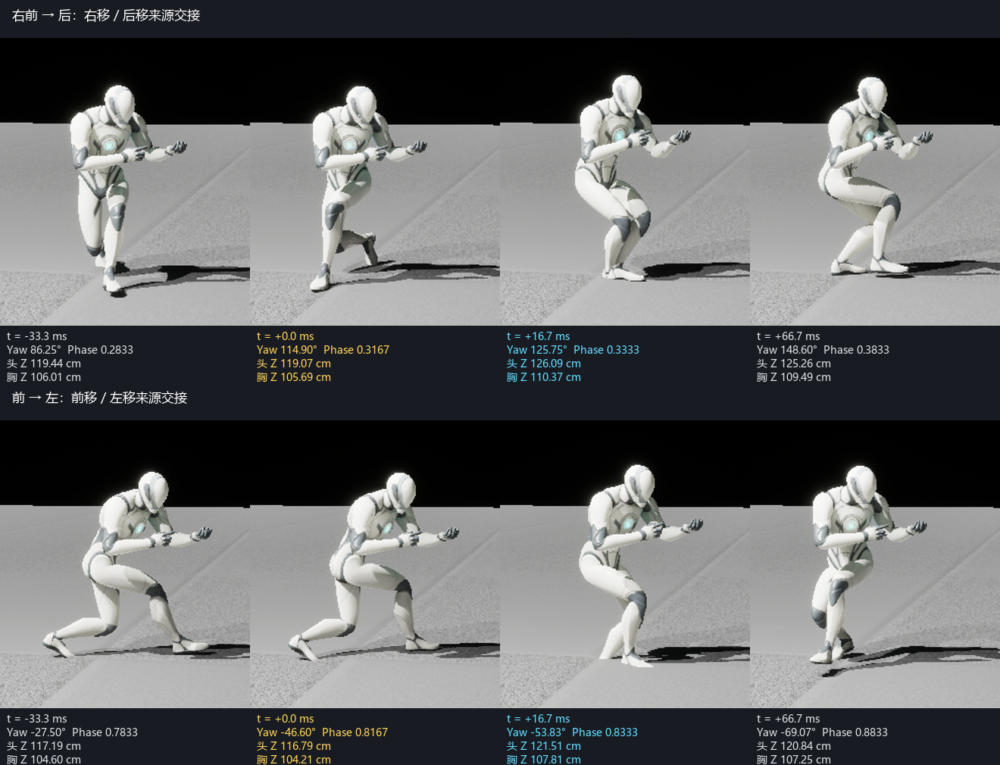

# 移动转换时上半身垂直位移排查

日期：2026-11-21。分支：codex/ue-5.8。范围：只读运行采样与观察。

## 结论

当前方向转换确实会导致上半身快速升降，幅度明显超过固定方向的正常步态起伏。
主要发生在基础动作来源交接时，而不是所有方向变化都会发生。

固定相位的原生重放确认，单独改变方向即可产生明显升高。
本轮没有修复，也没有修改动画、Skeleton、混合参数或生产代码。

## 实际环境与方法

- 地图：/Game/Experiments/Stance_20261022/L_OWLocalMovement。
- AnimClass：/Game/Experiments/Stance_20261022/ABP_OWLocalMovement。
- 网格：/Game/Characters/Mannequins/Meshes/SKM_Manny_Simple。
- 来源：同目录 AS_RootLockSource_Forward、Back、Left、Right 四段。
- 四路 Sequence Evaluator 共享 Phase，各经原生 Manual Orientation Warping。
- 三个全身 Layered Blend Per Bone 均关闭 Mesh Space Rotation Blend。
- 原生方向平滑 TurnSpeed=10；来源权重、OW 参数、拓扑均保持现状。
- 无 WeaponAction、AimOffset、Aim IK 或新接地处理。

采集八个固定方向各约两个周期、56 种有向切换各四个起始相位，以及双向连续扫描。
起始相位为 0、0.25、0.5、0.75；每次方向切换继续使用图内正常 Phase 推进和方向平滑。

使用现有运行时测试输入，暂时停用 Pawn 位移 Tick，让角色与网格世界变换保持固定。
这用于隔离动画自身的高度变化，不是一次新的键盘移动或 CharacterMovement 验收。
目标方向、相位初始化与采样代码均保存在本目录的脚本中。

主采样 12908 帧；其中八个用例出现较长编辑器帧间隔，单独重采 392 帧。
统计以重采结果替换这八个用例，见 FinalCaseMetrics.json。
重采无大于 50 ms 的帧间隔；所有主要结论案例均来自约 16.7 ms 的相邻帧。
不跨用例计算差值，不把初始化与前一个用例连接。

采集 22 个骨骼的组件位置与四元数，以及实际 Phase、Yaw、来源权重和 OW 角度。
本次网格仅绕 Z 轴旋转，组件 Z 与世界 Z 的增量相同。
角色、网格世界 Z 均为 0，相机 Z 始终为 135 cm。

## 固定方向基线

| 方向 | 头部完整起伏幅度 cm | 峰值垂直速度 cm/s |
| --- | ---: | ---: |
| 前 | 3.54 | 29.71 |
| 右前 | 3.55 | 29.71 |
| 右 | 2.19 | 21.16 |
| 右后 | 3.70 | 22.41 |
| 后 | 3.69 | 22.41 |
| 左后 | 3.69 | 22.41 |
| 左 | 2.51 | 22.71 |
| 左前 | 3.55 | 29.73 |

这些差异属于当前来源动作的实际表现，不构成统一骨盆或躯干姿势的理由。

前→右前、前→左前在四个相位下的头部峰值速度约 28～30 cm/s。
后→右后、后→左后约 22.41 cm/s。
这些路径保持同一主要来源，没有观察到与来源交接相当的额外头部突升。

## 四个交接区域

下表是测试覆盖内各交接区域最大的相邻帧头部变化。
区域名称表示来源交接，不代表只测试直接按下两个相邻方向的情况。

| 来源交接 | 代表测试输入 | 头部单帧变化 cm | 峰值速度 cm/s |
| --- | --- | ---: | ---: |
| 前／右 | 右→左前 | −2.43 | 145.59 |
| 右／后 | 右前→后 | +7.02 | 421.08 |
| 前／左 | 左后→右前 | −5.83 | 350.09 |
| 后／左 | 左后→前 | −3.59 | 215.22 |

更普通的前→左也出现明显上移：
在起始 Phase=0.75 时，头部单帧 +4.72 cm，胸部 +3.60 cm。
因此异常不只发生在大角度反向切换，也不只局限于以前未验收的左前、右后固定方向。

缓慢连续扫描时，顺时针与逆时针的头部峰值速度分别为 36.00、48.01 cm/s。
其严重程度低于突然改变目标方向的情况。
这里的数值只描述本轮采样，不代表所有转向速度与相位均已穷尽。

## 代表异常的准确两帧

右前→后，起始 Phase=0.25：

| 项目 | 第一帧 | 第二帧 |
| --- | ---: | ---: |
| SmoothedYaw ° | 114.89726257324219 | 125.747802734375 |
| Phase | 0.3166684992611408 | 0.3333352990448475 |
| 右来源权重 | 1.0 | 0.4440193394135239 |
| 后来源权重 | 0.0 | 0.5559806605864761 |
| 头部 Z cm | 119.07124022265096 | 126.08927209975467 |
| 胸部 Z cm | 105.68739113508965 | 110.36813831805684 |
| 骨盆 Z cm | 65.6257067629722 | 67.79769103872839 |

两帧相隔 0.016666799783706665 秒。
后移动作权重单帧从 0 增至 0.556，而不是节点被硬切换。
头部约 421 cm/s 的垂直速度，是固定方向基线峰值的约 14 倍。

头部 +7.018 cm 可拆为：

- root 骨组件 Z：+1.084 cm；
- pelvis 相对 root 的垂直差：+1.088 cm；
- 胸部相对 pelvis 的垂直差：+2.509 cm；
- 头部相对胸部的垂直差：+2.337 cm。

这里的 root 是骨骼，不是角色 Actor。
角色世界位置未升高，但原始动画和混合输出中的 root 骨仍有变化。
未启用 Root Motion 并不等同于骨骼 root 轨道恒定。

## 固定相位与单独时间推进

用现有测试输入锁定相位和方向，仍由相同原生 AnimGraph 求值：

| 案例 | 保持相位仅改方向：头 ΔZ | 保持方向仅推进相位：头 ΔZ |
| --- | ---: | ---: |
| 右前→后代表两帧 | +7.102 cm | −0.209 cm |
| 前→左代表两帧 | +5.053 cm | −0.219 cm |

两因素同时变化的实际头部增量分别为 +7.018、+4.722 cm。
因此本例的快速升高主要来自方向相关的姿态变化，不能由正常一帧的步态推进解释。

在第一例第二帧的同一相位，纯右来源头高为 118.862 cm，纯后来源为 125.168 cm。
实际混合输出为 126.089 cm，比两个端点都高。
按端点组件 Z 线性计算为约 122.368 cm，与真实 Local Space 混合输出不同。

这是组件位置的对照基准，不是要求改用位置线性插值。
它证明当前全身局部旋转混合中存在中间姿态上拱，不能只归因于两段动作高度不同。

前／左例中也观察到混合头高超过两个端点。
胸、颈相对骨盆的垂直差同时变化，视觉中表现为身体突然更直、肩头上移。

## 根因判断与边界

已证实：

1. 当前权重交接区间只有 20°，方向平滑仍可在少数帧内穿过该区间。
2. 不同来源在同一相位具有不同的完整身体姿态，包括 root、骨盆及脊柱。
3. 全身混合不只改变腿部，也会改变腰背、胸肩、颈头和双手。
4. 当前 Local Space 混合的中间姿态会产生额外上拱。
5. 这些因素共同产生可见的快速上半身升降。

未证实或本轮未做：

- 未将某个单一原生节点认定为引擎 Bug。
- 未证明统一来源身体高度或更换混合空间即可解决。
- 未开展新的权重策略、分层、相位对齐或修复对照。
- 未重新验收正式 Gameplay、第一人称持枪、多人网络或完整输入延迟。
- 本轮两组慢速扫描不是所有连续方向速度的穷尽测试。

优先研究的对象应是来源交接时的全身姿态组合与变化速度。
没有证据支持通过相机偏移、抬 Root 或统一原始身体高度来处理本问题。

## 视觉证据

两行分别为右前→后及前→左。
黄色列是异常前一帧，蓝色列是约 16.7 ms 后。
所有面板使用固定相机、相同裁剪范围，没有按角色或头部重新对齐。

18 张原生截图的重放骨骼位置与原采样逐项一致，最大误差 0 cm。
Visual.json 保存全部重放输入、骨骼、相机与误差。
本目录保留四张关键帧完整截图；其余截图在本轮 Saved 目录。

## 资产保护与交还

前后 SHA-256 检查覆盖 2246 个既存文件。
唯一变化是忽略的工作区进度文档；无文件丢失。
Content、Source、SourceAssets、Config、uproject 及既存历史报告均保持原样。

本轮新增的是本验证目录，以及 Saved/StanceUpperTransitionAudit_20261121_01 下的采样材料。
未新增、删除或修改任何 .uasset、动画源文件或生产／实验 C++。

已重启当前地图的可见 PIE，恢复人工预览：

- bTestOverride、bSnapInput、bManualPhase 均 false；
- Pawn Tick 启用，TurnSpeed 仍为 10；
- t.MaxFPS、后台节流、抗锯齿和运动模糊均恢复原值；
- 无脏内容资产或地图；
- 松开按键保持最后姿态，无 Idle，这仍是原实验行为。

本轮排查到此停止，未实施修复。

## 证据索引

- Audit.json：实际节点、引脚、引用、默认值。
- Frames.json.gz、RetryFrames.json.gz：完整运行时采样。
- FinalCaseMetrics.json：重采替换后的 234 个用例结果。
- Metrics.json、Details.json、Bands.json：基线、代表两帧与交接区域统计。
- Visual.json、UpperTransition_Compare.png、Shots/：原生重放和视觉证据。
- Runtime.json、Handoff.json、Protection.json：实际环境、恢复状态与保护检查。
- sample.py、retry.py、visual.py、analyze.py、retry_analyze.py、details.py：
  本轮只读采样与统计脚本，不是资产制作或自动修复工具。
