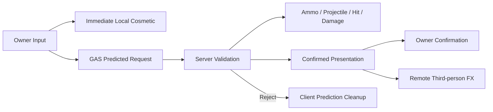

# ShootGame

[](https://www.unrealengine.com/)


基于 Unreal Engine 5.6 的多人网络射击学习项目。

项目以服务器权威、清晰的运行时职责和可重复验证为核心，逐步实现武器、Inventory、
Gameplay Ability、第一/第三人称表现、AI 与多人生命周期。当前重点是让每个网络闭环
都能被自动化证据证明，而不是单纯堆叠功能。

> 本项目仍在持续开发，不是可直接发布的完整游戏或通用射击框架。

## 当前能力

- 基于 GAS 的 Fire、Reload、Equip 能力与状态互斥；Fire / Reload 为 LocalPredicted。
- 一次 Fire Activation 对应一发 Shot；按武器持有关系授予 Fire Spec，隔离切枪与回池。
- Owner 本地立即播放纯表现，服务器独占 Ammo、Projectile、Hit、Damage 与 Score。
- Semi-auto 与 Full-auto 本地表现遵守武器 `RefireRate`，全自动由输入持续意图驱动逐发激活。
- 拥有者开火弹药预算与 HUD 显示预测、拒绝恢复和权威结清。
- Remote Client 只消费服务器确认后的第三人称表现。
- 武器启动配置快照、按类型预热的实体池，以及池耗尽后的按需 Spawn。
- Owner-only Inventory 数据、当前装备复制、双向切枪、死亡与断线清理。
- 第一/第三人称动画、瞄准同步、程序化 IK、Reload 与 Equip 表现。
- 本机预测开火动画在第三人称 Mesh 播放，第一人称经 CopyPose 继承。
- Walk / Sprint 移动预测、服务器动作门控与远端 Sprint 状态同步。
- Sprint 自动收枪；Fire 优先抬枪，到达真实动画端点后消费最多一次首发缓冲。
- Compact 贴身跑姿与步态同步；Rifle、AWP、GrenadeLauncher 共用收抬枪表现。
- 四枪可拆卸弹匣表现，以及已验收的 TP 左右脚 Notify 基础脚步音效。
- StateTree NPC、权威伤害、死亡、重生和基础计分流程。
- Build、Automation、Standalone、Dedicated、Listen、网络模拟与断线清理验证。
- Linux Dedicated Server 构建、打包与公网双客户端登录、角色复制验证。

## 网络射击边界



当前不预测真实 Projectile；客户端承担即时表现、开火弹药预算与 HUD 显示预测。
Server Accept / Reject 结清状态，Owner 确认不补播过去的瞬时开火表现。
真实 Ammo、Projectile、Hit、Damage 与 Score 仍由服务器产生。
换弹补满与备弹转移预测尚未接入。详细不变量见
[网络射击 AI 自主验证契约](Docs/架构/网络射击AI自主验证契约.md)。

近期继续完善表现，暂缓 Lobby / LAN Session。
本页功能概述截至 2026-10-17 的已提交基线，不包含工作区实验。

最新完整默认 RunAll 记录为 2026-10-16：七阶段全部通过，187 项 Automation 通过。
该轮首次带渲染运行曾发生 RifleReady.PIE 启动超时，单项带渲染复跑通过。
超时根因尚未定位；最终默认全量通过不等于整轮带渲染通过。
详见[完整回归记录][regression]。

2026-10-17 Compact 跑姿接入完成编译、九项网络、一项六俯仰 PIE 与两项脚步验证。
清理后再次通过六俯仰 PIE；未重跑完整 Cook、跨机器或全套网络射击不变量验证。
这些专项结果不能替代当前提交的完整回归，详见[跑姿提交记录][run-posture]。
长期目标见[总路线](Docs/执行计划/Shooter完整Demo最终路线规划.md)；
其中当前进度仍为 2026-10-08 快照，后续状态以本页所引记录和专题为准。

## 环境要求

- Windows 10/11 开发环境与客户端。
- Unreal Engine 5.6。
- Visual Studio 2022 与 C++ 游戏开发工具链。
- Windows SDK 10.0.22621 或兼容版本。

仓库提供了 [.vsconfig](.vsconfig)，Visual Studio 可据此安装所需组件。

Linux 专服已通过源码引擎构建、打包与公网双客户端登录验证。
公网移动、射击、伤害等完整玩法尚未完成验收，也不承诺服务器当前在线。
Linux 构建条件及验证边界见[部署说明](Docs/部署/LinuxDedicatedServer构建与跟踪.md)。

## 快速开始

```powershell
git clone https://github.com/fmoony/ShootGame.git
cd ShootGame
```

1. 确认 Unreal Engine 5.6 已安装。
2. 右键 `ShootGame.uproject` 生成 Visual Studio 项目文件，或运行项目刷新脚本。
3. 编译 `ShootGameEditor Win64 Development`。
4. 打开 `ShootGame.uproject`。
5. 加载 `/Game/Shooter/Maps/Lvl_Shooter` 开始运行。

默认 Walk，按住左 Shift 跑步，松开恢复；滚轮切枪。
跑动中按 Fire 会先抬枪，到位后开火；持续按住则沿用武器原有连发规则。
操作与取消边界见[Walk / Sprint 与自动收枪](Docs/WalkSprint与自动收枪.md)。

刷新工程文件：

```powershell
powershell.exe -NoProfile -ExecutionPolicy Bypass `
    -File .\Scripts\Development\RefreshVisualStudioFiles.ps1
```

编译编辑器目标：

```powershell
powershell.exe -NoProfile -ExecutionPolicy Bypass `
    -File .\Scripts\Tests\BuildEditor.ps1
```

## 自动化验证

完整回归入口：

```powershell
powershell.exe -NoProfile -ExecutionPolicy Bypass `
    -File .\Scripts\Tests\RunAll.ps1
```

总控依次执行：

1. `ShootGameEditor` 编译。
2. `ShootGame` Automation Tests。
3. Standalone 地图冒烟。
4. Dedicated Server 与两个客户端。
5. Listen Server 与远端客户端。
6. `100ms` 延迟、`2%` 丢包的网络模拟。
7. Reload / Equip、死亡与主动断线清理。

机器可读结果保存在：

```text
Saved/Automation/Runs/<timestamp>/Summary.json
```

更多命令、日志位置和判定方式见[自动化测试文档](Docs/自动化测试.md)。

## 源码结构

```text
Source/ShootGame/
├── AbilitySystem/    # GAS、属性与 Gameplay Effect 工具
├── AI/               # NPC、AIController 与 StateTree 支撑
├── Characters/       # 角色、瞄准、装备与动画数据源
│   └── Movement/     # 预测走跑、服务器动作门控与远端 Sprint
├── GameFramework/    # GameMode、GameState、Controller、PlayerState
├── Inventory/        # Owner-only Inventory 与运行时实例数据
├── Tests/            # Automation 与网络端到端验证
├── UI/               # HUD 与弹药显示
└── Weapons/          # 武器、配置、池、Pickup、开火行为与 Projectile
```

同级 `Source/ShootGameEditor/` 为 UncookedOnly 模块，承载动画图节点和编辑器工具、测试。
`Source/ShootGameServer.Target.cs` 提供 Dedicated Server 构建目标。
`Plugins/McpAutomationBridge` 是 Editor-only 自动化桥接插件，不参与运行时 Gameplay。

## 设计与开发文档

- [文档索引](Docs/README.md)
- [TP 脚步 Notify 与基础音效](Docs/TP脚步Notify与基础音效.md)
- [枪械可拆卸弹匣资产约定](Docs/枪械可拆卸弹匣资产约定.md)
- [Walk / Sprint 与自动收枪](Docs/WalkSprint与自动收枪.md)
- [Rifle 收枪动画表现](Docs/Rifle收枪动画表现.md)
- [Blender 动画编辑工具链](Docs/Blender动画编辑工具链.md)
- [Linux Dedicated Server 构建与跟踪](Docs/部署/LinuxDedicatedServer构建与跟踪.md)
- [Inventory 与武器数据架构](Docs/架构/Inventory与武器数据架构.md)
- [网络射击 AI 自主验证契约](Docs/架构/网络射击AI自主验证契约.md)
- [完整 Demo 最终路线规划](Docs/执行计划/Shooter完整Demo最终路线规划.md)
- [动画分层与射击表现扩展规划](Docs/执行计划/动画分层与射击表现扩展规划.md)
- [代码规范](Docs/代码规范.md)
- [Agent 自动化验证操作手册](Docs/Agent自动化验证操作手册.md)

## 协作约定

- 服务器产生权威 Gameplay 结果，客户端只提交输入与本地表现。
- 网络功能按可验证闭环逐步实现，避免同时扩大多个系统边界。
- 源码与文档遵守项目换行、宽度、include 和开发记录规范。
- 新提交必须附带开发记录，并通过 staged 文本检查与 `git diff --check`。

详细规则见 [AGENTS.md](AGENTS.md)。

## License

FMoony 独立创作且有权授权的程序代码采用 [MIT License](LICENSE)；这包括 C++、
脚本及自行编写的 Blueprint 逻辑。若文件同时包含其他来源的内容，MIT 仅适用于
FMoony 拥有权利的代码部分，不改变其他内容的许可。

- Unreal Engine 代码、模板与示例内容适用
  [Unreal Engine EULA](https://www.unrealengine.com/eula/unreal)，保留其版权声明。
- `Plugins/McpAutomationBridge` 中的第三方代码适用其目录内的
  [MIT 许可证](Plugins/McpAutomationBridge/LICENSE)，并保留原版权声明。
- `Content` 中的非代码资产不因本仓库的 MIT 声明获得授权；使用与再分发须遵守
  各资产来源的许可，包括适用时的
  [Epic Content License](https://www.unrealengine.com/eula/content) 或
  [Fab Standard License](https://www.fab.com/eula)。

[regression]: Docs/开发记录/2026-10-16-1732-生产代码显式类型整理.md
[run-posture]: Docs/开发记录/2026-10-17-2102-Rifle跑姿验收清理与提交.md
